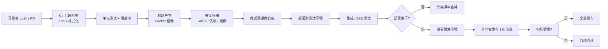

### **CI/CD 是一套让软件"从代码到用户"这条路径变得自动、频繁、可靠的工程实践，核心由持续集成（Continuous Integration）与持续交付/持续部署（Continuous Delivery/Deployment）两段组成。**

要真正把 CI/CD 讲清楚，最好的方式不是先抛术语，而是从"人为什么会需要它"这个最底层的问题往上搭。下面我会按照 **问题 → 原始做法 → 演化出的实践 → 现代工具链** 的顺序，一层层往上讲。

---

### **第 0 层：一切的起点——软件是"改出来的"**

任何一个软件从诞生到消亡，本质上就在做三件事：**写代码、把代码合起来、把合起来的东西交给用户运行**。

- 一个人写代码时，这三件事没什么难度：改完，编译，跑起来。
- 但只要人数变成 3 个、10 个、100 个，"把代码合起来"和"交给用户"这两步就会变成噩梦。

CI/CD 的所有历史，本质上都是在回答一个问题：**当参与者变多、变更变快时，如何避免软件在"合并"和"发布"这两个环节崩溃？**

---

### **第 1 层：最原始的做法——"集成地狱"（Integration Hell）**

上世纪 90 年代及以前，主流做法是：

- 每个开发者在自己电脑上，基于某个"主干版本"拉一份代码，然后**独自开发几周甚至几个月**。
- 到了里程碑节点，所有人把各自的改动合并到主干。
- 合并时冲突爆炸、接口对不上、编译不过、测试全红——团队进入长达数周的"集成期"，专门修合并出来的问题。

这个阶段被工程师们戏称为 **Integration Hell**。它暴露了两个底层规律：

1. **改动越久不合并，冲突成本越是指数级增长。**
2. **测试如果不在合并时立刻跑，缺陷会被埋很深，最后要花几十倍的代价去挖。**

于是有人开始想：**能不能让"合并"这个动作变得极其频繁、极其小、并且每次都自动跑测试？**

---

### **第 2 层：持续集成（CI）的诞生**

1991 年，Grady Booch 首次提出 "Continuous Integration" 这个词；到 1999 年，Kent Beck 在《Extreme Programming Explained》里把它变成极限编程（XP）的核心实践之一；2000 年前后，Martin Fowler 写下那篇著名的 *Continuous Integration* 文章，把它推向主流。

**CI 的底层定义非常朴素**：

> 每个开发者每天至少把自己的改动合并到主干一次，每次合并都由一台"共享的机器"自动拉取代码、编译、运行测试，一旦失败立刻通知所有人。

它带来的变化在于三个"自动化"：

- **自动构建**：不再靠某个"发布工程师"手工敲命令，而是脚本化（Make、Ant、Maven、Gradle……）。
- **自动测试**：单元测试（JUnit 系列，1997 年 Kent Beck 与 Erich Gamma 提出）成为 CI 的燃料，没有测试的 CI 是空壳。
- **自动反馈**：红/绿状态、邮件、聊天机器人通知，让"谁把主干搞坏了"在几分钟内就被发现。

这一层最早的工具代表是 **CruiseControl（2001）** 和后来的 **Hudson（2005）**，Hudson 在 2011 年分叉成了如今几乎无人不知的 **Jenkins**。

到这里，"合并"这一环节被基本驯服。但**发布**依然是件恐怖的事情——很多公司仍然要熬夜、封网、写几十页的上线手册，才能把 CI 产出的构建物真正推给用户。

---

### **第 3 层：持续交付（Continuous Delivery）**

2010 年，Jez Humble 和 David Farley 出版了《Continuous Delivery》一书，把下一步的实践系统化：

> **持续交付**的目标是让软件**在任何时刻都处于"可发布"状态**，也就是说，主干上的每一次提交，都应该能够被一键推送到生产环境。

它在 CI 的基础上，往后又延伸出了一整条"部署流水线"（Deployment Pipeline）：

$$
\text{提交} \rightarrow \text{构建} \rightarrow \text{单元测试} \rightarrow \text{集成测试} \rightarrow \text{类生产环境验证} \rightarrow \text{待发布产物}
$$

关键点在于两条：

1. **每一个环节都是自动化的**，人不再是流水线的传送带，而只是最后按"发布"按钮的那个决策者。
2. **产物是不可变的**（immutable artifact）：同一份构建物一路穿过测试环境、预发环境、生产环境，避免"测试环境跑得好、上线就出事"的经典问题。

到这一层，发布本身仍然由人来触发，但已经从"一次上线一次冒险"变成"一次上线一次例行公事"。

---

### **第 4 层：持续部署（Continuous Deployment）**

再往上一步，就是把最后那个"人按按钮"的动作也去掉：

> **持续部署**意味着任何通过流水线全部测试的提交，都会**自动、直接**进入生产环境，无需人工干预。

Facebook、Netflix、Amazon 等公司在 2010 年前后开始公开分享他们"每天上线上千次"的实践。Amazon 曾披露平均每 **11.7 秒**就有一次生产部署——这在传统运维视角里是不可想象的。

但持续部署对配套能力要求极高，它必须依赖：

- **完善的自动化测试金字塔**：单元测试、集成测试、端到端测试、契约测试、性能测试层层过滤。
- **渐进式发布策略**：蓝绿部署（Blue-Green）、金丝雀发布（Canary）、特性开关（Feature Flag），让"出事"时只影响 1% 的流量，而不是全站。
- **强大的可观测性**：日志、指标（Metrics）、链路追踪（Tracing）三件套，让异常在几秒内被检测到。
- **快速回滚能力**：出问题时不追求"修好"，而追求"秒级退回上一版本"。

所以业内常说的一句话是：**CD 中的 D，究竟是 Delivery 还是 Deployment，取决于你的组织有没有能力承担"完全无人上线"的风险。**

---

### **第 5 层：容器与云原生带来的第二次跃迁**

如果说 2000\~2010 年是 CI/CD 的"思想成型期"，那么 2013 年 **Docker** 的出现，则是它的"物理形态革命"：

- 构建产物从"jar/war/二进制 + 一堆环境依赖"，变成了**一个自带操作系统片段的镜像**，彻底解决了"在我机器上是好的"这一世纪难题。
- 2014 年 Google 开源 **Kubernetes**，让部署从"把包扔到某台服务器上"变成"向集群声明我要几个副本"，滚动更新、回滚、健康检查全部由平台负责。

在此之上，出现了几个进一步演化的分支：

- **GitOps**：以 Git 仓库作为系统"期望状态"的唯一真相源，Argo CD、Flux 等工具持续把集群实际状态向 Git 中声明的状态收敛。发布不再是"推"，而是"拉"。
- **流水线即代码（Pipeline as Code）**：Jenkinsfile、`.gitlab-ci.yml`、`.github/workflows/*.yml`，把整条流水线的定义放进代码库，和业务代码一起版本化、评审、回滚。
- **DevSecOps**：把安全扫描（SAST、DAST、依赖漏洞扫描、镜像扫描、密钥检查）嵌入流水线，让安全成为流水线上的一道普通关卡，而不是上线前的一次性大考。

---

### **第 6 层：今天一条典型的 CI/CD 流水线长什么样**

以一个用 GitHub + Kubernetes 的中型团队为例，从一次 `git push` 开始，通常会自动跑完下面这一整套：

主流工具在每一段的分布大致是：

| 环节 | 常见工具 |
|---|---|
| 源码与触发 | GitHub、GitLab、Gitee、Bitbucket |
| CI 引擎 | GitHub Actions、GitLab CI、Jenkins、CircleCI、Buildkite |
| 构建与产物 | Docker、Buildpacks、Bazel、Nexus、Harbor |
| 部署与编排 | Kubernetes、Argo CD、Flux、Spinnaker |
| 观测与回滚 | Prometheus、Grafana、OpenTelemetry、Sentry |

---

### **第 7 层：回过头看，CI/CD 的本质是什么**

从最底层的"集成地狱"，到今天几秒钟一次的自动上线，CI/CD 走过了将近三十年，但它的底层信念其实始终没变，可以浓缩成三句话：

- **让痛苦的事频繁做**：合并痛、就每天合；发布痛、就每天发。频率越高，单次的成本越低。
- **让机器做机器擅长的事**：编译、测试、部署、扫描、回滚这些确定性动作，全部交给流水线；把人的注意力留给设计、评审和判断。
- **让"可发布"成为一种默认状态**：主干在任意时刻都应能上线，这倒逼团队在架构、测试、监控、组织协作上做出深层次的改造——这也是为什么人们常说，**CI/CD 表面是工具链，骨子里是一种工程文化**。

理解到这一层，你再回头看那些花哨的工具、缩写和流水线图，就会发现它们都是同一个思想的不同投影：**用自动化和高频反馈，把软件交付这条路径变得像水一样平滑地流动起来。**