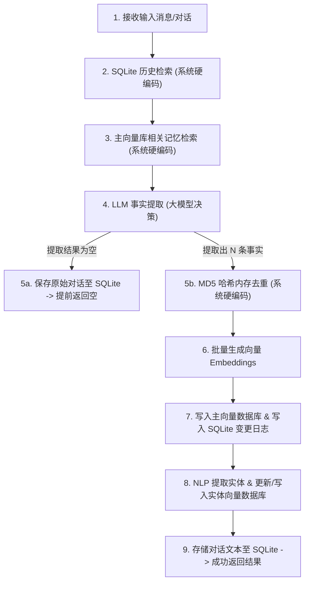
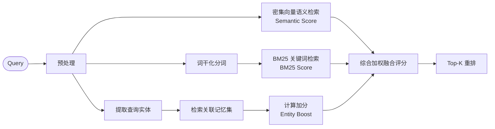

# Mem0 智能记忆系统架构设计与工作原理笔记

**Mem0** 是为 AI Agent 和大模型助手设计的持久化智能记忆层。它通过结合关系型数据库、密集向量检索和内置实体关联，使大模型能够记住跨会话的用户偏好、背景信息与历史事实。

以下是关于 Mem0 记忆系统（重点基于 v3 版本）的系统架构、数据流向以及性能损耗评估的详细技术笔记。

---

## 一、 三层存储架构 (Three-Tier Storage)

Mem0 并不单单依赖向量数据库，而是通过三种不同类型的存储介质协同管理记忆的不同生命周期：

| 存储介质                                 | 对应组件/表名                              | 主要作用                                                             | 读写特征                                                              |
| :----------------------------------- | :----------------------------------- | :--------------------------------------------------------------- | :---------------------------------------------------------------- |
| **本地关系型数据库** (SQLite)             | `messages` 表 `history` 表          | 1. 存储对话的原始消息流历史（Message Raw Context） 2. 记录记忆的变更日志（增/删事件及版本记录） | **硬编码自动执行** 每次 `add()` 对话文本必定追加写入；在写入主向量库成功后记录操作日志。            |
| **主向量数据库** (Main Vector Store)    | 默认 Collection (如 `mem0`)          | 存储由 LLM 提炼出的“事实片段”（Facts）及其密集的向量表征（Embeddings）。                  | **大模型过滤写入** 仅在 LLM 提取出新知识时触发写入；检索时通过稠密向量余弦相似度检索。               |
| **实体向量数据库** (Entity Vector Store) | 并行 Collection (如 `mem0_entities`) | 存储从事实中抽取的命名实体（如人名、物名、地名），记录每个实体关联了哪些主记忆 ID。                      | **硬编码构建索引** 仅在 LLM 产生新事实时，通过 NLP 库识别并写入/合并实体关联关系，用于实现轻量级关系图检索。 |

---

## 二、 写入管道流程 (Add Pipeline - Ingestion)

当应用程序调用 `Memory.add(messages, ...)` 时，触发一个 **V3 Phased Batch Pipeline**。整体逻辑可以划分为“系统性硬编码操作”与“LLM 主动决策操作”两个层面：

### 详细步骤说明
1. **上下文提取（硬编码必定触发）**：
   * 在 [SQLite 历史数据库](file:///Users/williamlao/Project/mem0/mem0/memory/storage.py) 中读取该 `user_id` 最近的 10 条原始对话历史。
   * 以新输入消息的 Embedding 向量去**主向量数据库**检索前 10 条相关的已有事实片段。
2. **大模型决策与事实提炼（核心过滤点）**：
   * 将上述“原始对话历史”与“相关的已有记忆事实”拼接进 System Prompt，送往 LLM 执行单阶段事实提炼。
   * **阻断决策点**：
     * **若 LLM 判定没有新知识**：程序在此阻断，直接调用 `self.db.save_messages()` 将此轮对话追加进 SQLite，并提前 `return []`，**不与任何向量库发生交互**。
     * **若 LLM 判定有新知识**：输出新事实（如 "User likes drinking green tea"）。
3. **写入与哈希去重（硬编码）**：
   * 计算新提取事实的 MD5 码，与当前已检索出的旧事实 MD5 对比。若相同则在内存中直接过滤丢弃（防止存储完全相同的事实）。
   * 将通过过滤的事实送往 Embedding API 转换为高维稠密向量，并批量写入**主向量数据库**。
   * 将本次 `ADD` 操作的事件及 memory_id 批量记入 [SQLite 变更日志](file:///Users/williamlao/Project/mem0/mem0/memory/storage.py)。
4. **实体链接建立（LLM 有提取时必定触发）**：
   * 使用 `spaCy` (或备用匹配算法) 从新入库的事实文本中提取实体词干（例如 `"green tea"`）。
   * 对实体文本向量化，去**实体向量数据库**搜索是否存在相同或极为接近的实体（相似度 $\ge 0.95$）。
   * **若存在**：更新该实体的 payload，将新记忆的 `memory_id` 追加至 `linked_memory_ids` 字段并写回。
   * **若不存在**：在实体向量数据库中插入新实体，存储实体名称、类别以及其关联的 `memory_id` 列表。

---

## 三、 混合检索评分机制 (Retrieval & Score Fusion)

当用户调用 `Memory.search(query)` 检索记忆时，Mem0 弃用了单一的向量检索，转而使用由三个检索信号加权融合的**混合检索评分管道**：

1. **密集向量语义检索 (Semantic Similarity)**：
   * 对 `query` 编码，并在主向量数据库中执行 Top-K 的近似最近邻（ANN）查询，获取候选记忆集。
2. **BM25 关键词精确匹配 (BM25 Score)**：
   * 使用 NLP 模块对 `query` 进行词干化处理（Lemmatization），并在支持的数据库上进行全文/稀疏向量搜索，计算 BM25 关键词相关度分值。这能够防止向量模型常见的“语义模糊幻觉”。
3. **实体关系增强 (Entity Boost Weight)**：
   * 提取 `query` 中的实体（去重后最多 8 个）。
   * 对实体文本向量化，并行检索**实体向量数据库**中相似度 $\ge 0.5$ 的关联实体。
   * 根据匹配实体的相似度以及它关联的主记忆条目数量计算实体增益权重：
     $$\text{Boost} = \text{Similarity} \times \text{ENTITY\_BOOST\_WEIGHT} \times \frac{1}{1.0 + 0.001 \times (N_{\text{linked}} - 1)^2}$$
   * 增益权重直接叠加在主记忆 ID 的总分上，使“包含相同核心实体”的记忆在重排时能大幅前移。

---

## 四、 核心版本演进 (v2 vs v3)

Mem0 团队在 v3 版本中对系统架构进行了极为关键的减负与算法重构：

### 1. 放弃外部图数据库 (Neo4j/Memgraph)
* **旧版 v2**：可选配置 Neo4j 或 Memgraph，在外部库维护一个实际的实体图谱。但网络交互开销极大，且维护两个复杂系统的开发成本过高。
* **新版 v3**：**彻底移除了所有外部图数据库的代码（砍掉约 4000 行图驱动代码）**。转而在已有的向量数据库中并行创建一个专用的 `{collection_name}_entities` 集合，采用“实体 Embedding $\rightarrow$ 关联 Memory IDs 列表”的浅表索引方式，在无外部依赖的情况下实现了相似的关联增强效果。

### 2. Collapsed Extraction (提取管道坍缩)
* **旧版 v2**：需要经历两阶段 LLM 调用。第一阶段提取新事实，第二阶段拿新事实跟已检索到的事实在 LLM 里进行 Diff，由大模型判定执行 `ADD`、`UPDATE` 还是 `DELETE` 操作。
* **新版 v3**：重构为单阶段大模型调用（ADD-only）。只要求 LLM 提炼出当前对话中的事实，冲突解决和排重移交到了哈希匹配以及检索阶段。这一改动使大模型提取耗时与 Token 成本**下降了约 50%**，同时在 LoCoMo 和 LongMemEval 基准测试上分别提升了 **+20** 和 **+26** 个百分点。

---

## 五、 生产环境下的损耗评估与优化指南

### 1. “每步触发”面临的损耗
如果在每次 AI 客服/智能体对话中，都同步调用 `Memory.add(messages)`，会产生明显的资源和性能负担：
* **时延开销**：同步链路包含至少 1 次 LLM 调用 + 1-2 次 Embedding 转化，使用户在聊天界面感受到明显的卡顿。
* **费用开销**：每轮对话都会向大模型发送庞大的上下文 Prompt（包含已有记忆与历史消息），消耗大量 Input Tokens，账单增长极快。
* **限频阈值**：极易耗尽各大模型服务商的 RPM/TPM 限频额度。

### 2. 生产优化实践建议
* **异步后台提取 (Background AsyncTask)**：
  使用 [AsyncMemory](file:///Users/williamlao/Project/mem0/mem0/memory/main.py#L2095) 进行非阻塞调用。先将 AI 回复输出给用户，再通过后台协程或消息队列（如 Celery/Redis）异步执行记忆入库流程。
* **限制触发频率 (Batched Actions / Idle Detection)**：
  * **按轮次累积**：每隔 $N$ 轮对话才整体触发一次 `add()`。
  * **闲时触发**：监测用户活动，当用户超过 2 分钟未发送新消息时，视为本轮对话段落结束，此时再提取记忆。
  * **会话结束触发**：在用户选择“新开对话”或“关闭页面”时，一次性把整段 Session 传给 Mem0。
* **前置启发式过滤 (Heuristics Filter)**：
  在应用层编写简单的本地过滤器，对于无意义的问候语（如 "Hello"、"Yes"、"OK"）直接跳过 `Memory.add()` 流程，仅在检测到具有高信息密度文本（通过简单词表或便宜的本地分类小模型）时，才激活 Mem0 写入管道。
