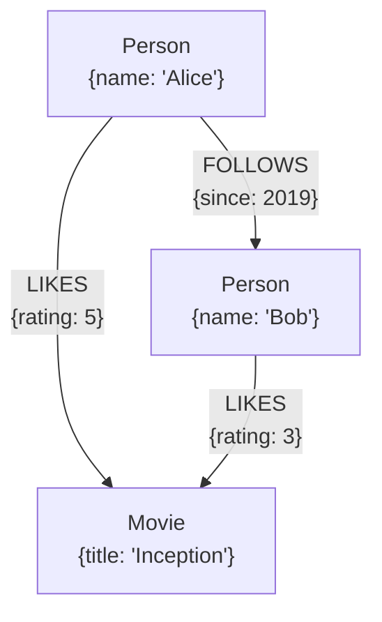

# 图数据库的历史与原理

**Created:** 7/14/2026 6:55:25  
**Updated:** 7/14/2026 7:03:03  
**Exported:** 7/15/2026 2:37:06  
**Link:** [https://claude.ai/chat/4ebc9a6e-ba5b-4566-b9dc-27ac8071486a](https://claude.ai/chat/4ebc9a6e-ba5b-4566-b9dc-27ac8071486a)  

## User:

> 7/14/2026 6:55:40

说说图数据库，之前从来没接触过，你教教我，最好结合点历史，我喜欢搞清楚来龙去脉，搞明白原理

## Assistant:

> 7/14/2026 6:57:02

> 组织历史脉络、原理机制与实战建议的教学框架。
>
> - The user is asking for a comprehensive introduction to graph databases covering their history, foundational principles, and origins. I can draw on established knowledge here since these concepts are well-established, though I should acknowledge that the current market landscape may have evolved. They've written in Chinese, so I'll respond in that language. I'm also considering whether to include visuals, though the system prompt seems to be cut off on that point.
>   
>   I'm thinking a diagram showing the property graph model would genuinely help illustrate the concepts, especially since graph structures are inherently visual and the user is asking for an educational explanation. I'll plan the response to start with why graph databases matter (the limitations of relational databases with complex joins), then trace the historical evolution from network and hierarchical databases in the 1960s-70s, through Codd's relational model revolution and the famous debate with Bachman, and into the modern graph database era. The key insight is that relational databases hide relationships in foreign keys and joins that are computed at runtime, whereas graph databases make relationships explicit and traversable. Amazon Neptune (2017) 和 Dgraph 等分布式图数据库随之出现。2019 年后，GQL 被立项为国际标准，预计 2024 年发布为 ISO 标准，成为继 SQL 之后第二个数据库查询语言标准。最近几年知识图谱与 LLM/RAG 的结合也成为热点。现在看一下原理层面，属性图模型用节点、关系、标签和属性来表示数据，而 RDF 则采用三元组方式，其中最关键的是免索引邻接这一核心机制。
>   
>   节点直接存储指向相邻关系的指针，这样遍历时每一跳都是 O(1) 的常数时间，与整个图的规模无关，相比之下关系型数据库的 join 操作需要索引查找或哈希连接，效率要低得多。Neo4j 的实现采用固定大小的记录，节点记录存储第一个关系的 ID，而关系记录则是双向链表结构，通过指针算术来定位。Cypher 查询语言用 ASCII art 的模式匹配来表达查询，执行时采用展开而非 join 的方式，支持变长路径和最短路径查询，大多数原生图库都支持 ACID 事务。不过图数据库也有局限，全局聚合分析的性能较差，而且图的分片非常困难，因为图划分本身是个 NP-hard 问题。
>   
>   此外还要考虑写吞吐的瓶颈和超级节点的性能问题。现在我需要总结什么时候应该用图数据库、什么时候不应该用，以及新手上手的建议，同时准备一个具体的 join 对比例子和 Cypher 代码片段，再加上一个展示属性图和索引的图表。
>   
>   我想创建一个清晰的属性图模型图表，对比关系表 join 和图遍历指针的成本差异。这样能更直观地说明图数据库的优势。我需要调用可视化工具来生成这个图表。
>   
>   现在让我核实一些关键的历史事实：IDS 由 Charles Bachman 在通用电气开发于 1964 年左右，他因此获得了 1973 年的图灵奖；IMS 是 IBM 与洛克威尔/卡特彼勒合作为阿波罗计划开发的，时间在 1966-68 年；CODASYL DBTG 报告发布于 1969/1971 年；Codd 的关系模型论文发表在 1970 年的 CACM；1975 年在密歇根州安娜堡举行的 SIGMOD 大会上发生了著名的"大辩论"，Codd 和 Bachman 进行了对话；Neo4j 由 Emil Eifrem 等人创立，最初是 Windh Technologies 的内部项目，2007 年开源；Cypher 语言在 2011 年左右推出，openCypher 在 2015 年发布；Gremlin/TinkerPop 大约在 2009 年出现，现在是 Apache 项目；SPARQL 是 W3C 的推荐标准，1.0 版本在 2008 年发布，1.1 版本在 2013 年发布；GQL 是最新的 ISO/IEC 39075:2024 标准，2024 年 4 月发布。
>   
>   SQL/PGQ 现在是 SQL:2023 的一部分；Pregel 论文发表于 2010 年的 SIGMOD；Facebook 的 TAO 论文发表于 2013 年的 USENIX ATC；Amazon Neptune 在 2017 年作为预览版发布，2018 年正式上线；Microsoft 在 2024 年发布了 GraphRAG。
>   
>   "索引无邻接"这个术语是由 Neo4j 和《图数据库》一书（Robinson、Webber、Eifrem 著）推广的。不过需要注意的是，并非所有"图数据库"都使用索引无邻接的方式；许多是建立在其他存储系统之上的，比如 JanusGraph 建立在 Cassandra/HBase 上，Neptune 和 AWS 的其他产品也是如此。
> - **Done**

先说结论：图数据库不是什么"新发明"，它其实是数据库世界里的一次**回归**——回到了关系模型出现之前的思路，再用现代的方式重做一遍。理解这个历史转折，原理就自然明白了。

## 一、史前时代：数据库本来就是"图"

1960 年代第一批数据库，走的就是"指针导航"路线。

- **IDS**（Integrated Data Store，Charles Bachman，通用电气，1964 年前后）——网状模型。记录之间用物理指针互相串联，程序员写代码就是"从这条记录顺着指针爬到那条记录"。
- **IMS**（IBM，1966 年为阿波罗登月计划的物料清单做的）——层次模型，本质是树。
- 1969/1971 年 CODASYL 委员会把网状模型标准化。

这类数据库快、贴近硬件，但有个致命问题：**查询逻辑和物理存储结构死死绑在一起**。表结构一改，所有应用程序都得重写。程序员必须自己"导航"，脑子里得装着整个数据布局。

## 二、Codd 的革命：关系模型（1970）

1970 年 E.F. Codd 在 CACM 发表《A Relational Model of Data for Large Shared Data Banks》，提出：数据就是一堆二维表（数学上是集合和关系），用户只说**要什么**（声明式），不说**怎么取**（导航式），由优化器决定执行路径。

这带来了"数据独立性"——存储怎么变，查询语句不用改。

1975 年在 SIGMOD 上有一场著名的"大辩论"，Bachman（网状派）对阵 Codd（关系派）。历史结果大家都知道了：关系模型赢得彻底，SQL 统治了接下来五十年。

**但这里有一个代价，是理解图数据库的关键**：

关系模型把"关联"这件事**变成了值的匹配**。A 表的外键等于 B 表的主键——这个关联不是存下来的,是**每次查询时现算的**。这个"现算"就叫 JOIN。

数据本身有的那个"连接"，在关系模型里被抹掉了,只剩下"两个数字碰巧相等"。

## 三、代价什么时候变得无法忍受

单跳 JOIN 很便宜。问题出在**深度关联**上。

设想社交网络找"朋友的朋友的朋友"：

```sql
SELECT ... FROM person p1
JOIN friendship f1 ON p1.id = f1.a
JOIN person p2 ON f1.b = p2.id
JOIN friendship f2 ON p2.id = f2.a
JOIN person p3 ON f2.b = p3.id
JOIN friendship f3 ON ...   -- 每加一跳就多两个 JOIN
```

每一跳都要走一遍索引（B+ 树，O(log N)），而且中间结果集是**乘法级膨胀**的。跳数从 2 加到 5，很多真实系统上响应时间从毫秒变成分钟甚至超时。更糟的是，"跳几次"这件事在 SQL 里根本不好表达——你事先不知道要 JOIN 几次。

到了 2000 年代中后期，三件事同时爆发：
1. **Web 本身就是图**（超链接结构，PageRank 就是图算法）
2. **社交网络**（Facebook、LinkedIn 的核心资产就是关系本身）
3. **推荐、风控、知识图谱**——都是"关系比实体更重要"的场景

这时候人们回头想：既然关联本身就是一等公民，为什么每次都要现算？直接把它**存下来**不就行了？

## 四、复兴：图数据库登场

- **2000s 初，语义网路线**：W3C 推 RDF（三元组：主-谓-宾）和查询语言 SPARQL（2008 成为标准）。这是"知识表示"血统，学术和数据集成味道浓。
- **2007，Neo4j 开源**。它源自瑞典一家做媒体资产管理的公司——他们发现自己的数据用关系表建模极其别扭，干脆自己写了个存关系的引擎。它带来了**属性图（Property Graph）**模型，这是今天工业界的主流。
- **2010s，大厂自研**：Google 的 Pregel（2010，分布式图计算）、Facebook 的 TAO（2013，社交图存储）、Twitter 的 FlockDB。
- **查询语言**：Neo4j 的 Cypher、Apache TinkerPop 的 Gremlin 各自发展。
- **2024，ISO/IEC 39075 GQL 正式发布**——继 SQL 之后**第二个** ISO 国际标准数据库查询语言。这是图数据库"转正"的标志性事件。同时 SQL:2023 也加了 SQL/PGQ，让关系库能跑图查询。

## 五、原理一：属性图数据模型

属性图只有四个概念：

## User:

> 7/14/2026 6:57:14

说说图数据库，之前从来没接触过，你教教我，最好结合点历史，我喜欢搞清楚来龙去脉，搞明白原理

## Assistant:

> 7/14/2026 7:03:03

> 组织图数据库教学框架，设计示意图展示。
>
> - I need to provide a complete answer about graph databases in Chinese, including the history and principles, along with a property graph diagram showing nodes like Person and Movie with relationships like ACTED_IN and FRIEND.
>   
>   I'm laying out the SVG diagram with three main nodes — Alice and Bob as Person nodes on the left, and Inception as a Movie node on the right — connected by relationship edges labeled with properties like "FOLLOWS since:2019" and "LIKES", positioning the labels carefully to avoid overlapping with the connecting lines. Writing SVG markup...
> - **Done**

先给个结论：图数据库并不是凭空冒出来的"新玩意"，它其实是数据库世界的一次**回归**——回到关系模型出现之前的老思路，再用现代方式重做一遍。把这个转折搞清楚了，原理自然就通了。

## 一、史前时代：数据库本来就是"图"

1960 年代的第一批数据库，走的就是"指针导航"路线：

- **IDS**（Charles Bachman，通用电气，1964 年前后）——网状模型。记录之间用物理指针串起来，程序员写代码就是"顺着指针从这条记录爬到那条记录"。
- **IMS**（IBM，1966 年为阿波罗登月的物料清单而做）——层次模型，本质是一棵树。
- 1969/1971 年 CODASYL 委员会把网状模型标准化。

这类系统快、贴硬件，但有个致命伤：**查询逻辑跟物理存储结构死死绑死**。结构一改，所有应用程序都得重写；程序员脑子里必须装着整个数据布局。

## 二、Codd 的革命（1970）

E.F. Codd 发表《A Relational Model of Data for Large Shared Data Banks》，主张：数据就是一堆二维表（数学上是集合与关系），用户只说**要什么**（声明式），不说**怎么取**（导航式），由优化器决定执行路径。

这带来了"数据独立性"——存储怎么变，查询语句不用改。1975 年 SIGMOD 上有场著名的"大辩论"，Bachman（网状派）对阵 Codd（关系派）。结果大家都知道了：关系模型赢得彻底，SQL 统治了此后五十年。

**但这里埋了个代价，是理解图数据库的关键**：

关系模型把"关联"变成了**值的匹配**——A 表的外键等于 B 表的主键。这个关联不是存下来的，是**每次查询时现算的**。这个"现算"就叫 JOIN。

换句话说：数据里那个真实存在的"连接"，在关系模型中被抹掉了，只剩下"两个数字碰巧相等"。

## 三、代价什么时候变得无法忍受

单跳 JOIN 很便宜。问题出在**深度关联**上。比如社交网络里找"朋友的朋友的朋友"：

```sql
SELECT ... FROM person p1
JOIN friendship f1 ON p1.id = f1.a
JOIN person p2 ON f1.b = p2.id
JOIN friendship f2 ON p2.id = f2.a
JOIN person p3 ON f2.b = p3.id
JOIN friendship f3 ON ...   -- 每多一跳就多两个 JOIN
```

每一跳都要走一遍索引（B+ 树，O(log N)），中间结果集还是**乘法级膨胀**。跳数从 2 加到 5，很多真实系统上响应从毫秒变成分钟甚至超时。更麻烦的是，"到底跳几次"这件事在 SQL 里根本不好表达——你事先不知道要 JOIN 多少次。

到 2000 年代中后期，三件事同时爆发：

1. **Web 本身就是图**（超链接结构，PageRank 就是图算法）
2. **社交网络**（Facebook、LinkedIn 的核心资产就是"关系"本身）
3. **推荐、风控、知识图谱**——都是"关系比实体更重要"的场景

于是人们回头一想：既然关联本身就是一等公民，为什么每次都要现算？直接把它**存下来**不就行了？

## 四、复兴

- **2000s 初，语义网路线**：W3C 推 RDF（三元组：主-谓-宾）和查询语言 SPARQL（2008 年成为标准）。这是"知识表示"血统，学术与数据集成味道浓。
- **2007，Neo4j 开源**。它源自瑞典一家做媒体资产管理的公司——他们发现自己的数据用关系表建模极其别扭，干脆自己写了个专门存关系的引擎。它带来了**属性图（Property Graph）**模型，这是今天工业界的主流。
- **2010s，大厂自研**：Google 的 Pregel（2010，分布式图计算）、Facebook 的 TAO（2013，社交图存储）、Twitter 的 FlockDB。
- **查询语言**：Neo4j 的 Cypher、Apache TinkerPop 的 Gremlin 各自发展。
- **2024，ISO/IEC 39075 GQL 正式发布**——继 SQL 之后**第二个** ISO 标准数据库查询语言。这是图数据库"转正"的标志。同时 SQL:2023 加入了 SQL/PGQ，让关系库也能跑图查询。

## 五、原理一：属性图数据模型

属性图只有四个概念：**节点、关系（有方向、有类型）、标签、属性**。关键在于——**关系本身也能带属性**，这是关系型的外键做不到的。

> [Interactive Widget: property_graph_model_example]

> 放弃图表工具，改用文字描述继续作答。
>
> - The diagram tool isn't working, so I'll describe this in text instead and continue with the answer.
> - **Done**

（图形渲染工具刚好没响应，我用文字画一下这个例子）

```
  (Person {name:"Alice"})  --[:FOLLOWS {since:2019}]-->  (Person {name:"Bob"})
           |                                                     |
   [:LIKES {rating:5}]                                  [:LIKES {rating:3}]
           |                                                     |
           +--------->  (Movie {title:"Inception"})  <-----------+
```




注意三点：

1. **节点有标签**（`Person`、`Movie`），相当于"类型"。
2. **关系有方向、有类型**（`FOLLOWS`、`LIKES`）。
3. **关系自己也带属性**（`since`、`rating`）。在关系型里，你得为此额外建一张关联表。

（另一条技术路线是 RDF 三元组：把一切都拆成"主-谓-宾"，比如 `Alice likes Inception`。它更适合数据交换和推理，但表达"边的属性"很别扭，得用 reification 这类绕路手段。工业界主流是属性图。）

## 六、原理二：免索引邻接（Index-Free Adjacency）

**这是图数据库最核心的机制，也是它和"在 MySQL 里建两张表模拟图"的本质区别。**

原生图数据库（以 Neo4j 为例）的存储大致是这样：

- 节点记录是**固定长度**的（比如 15 字节）。所以想找 ID 为 N 的节点，不用查索引，直接 `偏移量 = N × 记录大小`，一次**指针算术**就定位到了，O(1)。
- 每条节点记录里存着一个字段：**"我的第一条关系的 ID"**。
- 每条关系记录里存着：起点 ID、终点 ID、关系类型、以及**四个指针**——起点的上一条/下一条关系，终点的上一条/下一条关系。

也就是说，关系被组织成了**双向链表**。

于是"从 Alice 出发找她的朋友"这个操作变成了：定位 Alice 的记录 → 拿到 first relationship id → 顺着链表一路走 → 每条关系直接给你对端节点 ID → 再定位。

**全程没有索引查找，没有 JOIN，没有全表扫描。每一跳都是常数时间的指针跳转。**

这就是关键的复杂度差异：

| | 关系型 JOIN | 图遍历 |
|---|---|---|
| 单跳成本 | O(log N)（N = 全表行数） | O(1)（跟图有多大**无关**） |
| 成本随什么增长 | **整个数据库的规模** | **只跟你实际走过的邻居数有关** |
| 深度遍历 | 指数级中间结果膨胀 | 线性于访问到的节点数 |

一句话概括：**关系型数据库的查询代价取决于数据库有多大；图数据库的查询代价只取决于你走了多远。** 这就是为什么图数据库能在几十亿节点的图上，几毫秒完成一次五跳查询。

也正因为如此，"图数据库"这个词是有含金量的：只有把关系当作物理指针存下来的，才叫**原生（native）图存储**。有些系统（比如 JanusGraph 架在 Cassandra 上、或者早期一些图产品）本质是把图映射到 KV/列存上，遍历时仍然要走索引查找——性能特征跟原生图完全不同。这是选型时值得追问的一点。

## 七、原理三：查询语言

Cypher 的设计思想很聪明：**用 ASCII 画图**。`()` 是节点，`-->` 是关系。

```cypher
// 找 Alice 的朋友的朋友，但排除已经是她直接朋友的人
MATCH (a:Person {name:'Alice'})-[:FOLLOWS]->()-[:FOLLOWS]->(fof)
WHERE NOT (a)-[:FOLLOWS]->(fof) AND fof <> a
RETURN fof.name
```

对比一下前面那坨 JOIN，你会发现查询语句的**形状本身就长得像它要匹配的图**。

更妙的是**变长路径**——SQL 完全无法优雅表达的东西：

```cypher
// 1 到 6 跳之内，Alice 能连到谁
MATCH (a:Person {name:'Alice'})-[:FOLLOWS*1..6]->(x)
RETURN DISTINCT x.name

// 两点之间的最短路径
MATCH p = shortestPath((a)-[:FOLLOWS*]-(b))
RETURN p
```

从执行模型看，图查询的基本算子不是 JOIN，而是 **expand（展开）**：从一批已知节点出发，沿着某类关系扩张到下一批节点。整个查询就是一串 expand + filter。

## 八、代价与局限（这部分很多教程不讲）

图数据库不是银弹，工程上有几个真实的坑：

1. **分片极难**。关系型可以按 user_id 哈希切分；但图要分片，你得把图切开——而"最小割"图划分是 NP-hard 问题。更糟的是，切开之后，跨机器的一跳遍历就从"指针跳转"变成了"网络往返"，快了几个数量级的优势瞬间蒸发。所以很多图数据库的做法是**尽量单机放得下**（内存/SSD 塞大点），或者用复制而非分片来扩展读。
2. **超级节点（supernode）问题**。某个节点有一千万条边（比如一个千万粉丝的大 V），遍历到它时链表就爆了。需要特殊处理（关系类型分桶、度数限制等）。
3. **全局聚合分析弱**。"统计所有订单的总金额"这种事，列式存储（ClickHouse 之类）能吊打图数据库。图库擅长的是**局部深度遍历**，不是**全局扫描聚合**。
4. **写吞吐通常不如 KV**。维护那些双向链表指针是有代价的。

## 九、什么时候该用

**该用**：关系本身就是你要查询的对象，且需要多跳。典型场景——
- 反欺诈（这笔交易的设备、IP、银行卡，跟已知欺诈团伙隔几跳？）
- 推荐（买了这个的人还买了什么）
- 权限/组织架构（这个人通过多少层继承拿到了这个权限）
- 知识图谱、供应链溯源、网络拓扑、族谱
- 近两年很火的 **GraphRAG**：把知识图谱接进 LLM 检索，解决向量检索"只能找相似片段、无法回答需要跨文档串联的问题"

**不该用**：数据本质是扁平表格、查询主要是过滤+聚合、关联深度不超过两跳。那 PostgreSQL 加个索引就完事了，别自找麻烦。

## 十、怎么上手

最快的路径：

1. 装 Neo4j Desktop 或者用它的免费云版 AuraDB。
2. 跑内置的示例数据集（`:play movies`），花一小时把 Cypher 的 `MATCH / WHERE / RETURN / CREATE` 玩熟。
3. 想深入原理，读 O'Reilly 的《Graph Databases》（Robinson、Webber、Eifrem 著，免费电子版），第 6 章专门讲底层存储和免索引邻接。
4. 想理解取舍，找 Neo4j 官方博客里讲存储结构那几篇，以及 Facebook 的 TAO 论文（看看大厂为什么最终没用现成的图数据库，而是自研）。

---

一条主线串起来：**导航式（1960s）→ 声明式但关系被隐去（1970s，Codd）→ 关系重新成为一等公民，但保留声明式查询（2000s+，图数据库）**。图数据库拿走了 Bachman 的"关系是物理存在的"，也拿走了 Codd 的"用户不该操心怎么取"，把两者合在了一起。

要不要我挑一个具体场景（比如反欺诈或推荐），从建模到 Cypher 查询完整走一遍？那样原理会更落地。

Powered by Claude Exporter (https://www.ai-chat-exporter.net)
