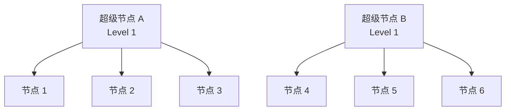

# 模块度 $Q$ 怎么算

我们用一个只有 **4 个人** 的极简网络，一步步手动算一遍。

---

### 1. 设定网络结构（4 个人，3 条边）

假设有 A、B、C、D 四个人，连接关系如下（一条“哑铃”形状的线）：

$$\text{A} \text{ — } \text{B} \text{ — } \text{C} \text{ — } \text{D}$$

* **关系（边）**：(A, B)、(B, C)、(C, D)
* **总边数 $m$** = 3 条
* **每个人的“度数”（相连的边数 $k$）**：
  * A 连了 1 个人 $\to k_A = 1$
  * B 连了 2 个人 $\to k_B = 2$
  * C 连了 2 个人 $\to k_C = 2$
  * D 连了 1 个人 $\to k_D = 1$
  * 所有节点的度数总和 = $1 + 2 + 2 + 1 = 6$（正好是总边数的 2 倍，即 $2m = 6$）

---

### 2. 模块度的计算公式

在实际计算中，一个社区 $C$ 的模块度贡献公式为：

$$\text{社区 } C \text{ 的得分} = \frac{L_C}{m} - \left( \frac{D_C}{2m} \right)^2$$

* **$\frac{L_C}{m}$**：**实际内部边占比**（社区内部实际有多少条边 / 全图总边数 $m$）。
* **$\left( \frac{D_C}{2m} \right)^2$**：**随机期望边占比**（如果这群人随机连线，预计落在社区内部的边占比）。
* **总模块度 $Q$** = 所有社区得分相加。

---

### 3. 对比两种划分方案的得分

我们来看**按直觉划**和**乱划**的得分差异：

#### 方案一：合理的划分（把链条从中间切开）
* **社区 1**：{A, B}
* **社区 2**：{C, D}

##### 计算 社区 1 {A, B} 的得分：
1. **实际内部边 $L_1$**：A 和 B 之间有 1 条边 $\to L_1 = 1$
2. **节点度数和 $D_1$**：$k_A + k_B = 1 + 2 = 3$
3. **得分**：
   $$\text{得分}_1 = \frac{1}{3} - \left( \frac{3}{6} \right)^2 = \frac{1}{3} - \left(\frac{1}{2}\right)^2 = \frac{1}{3} - \frac{1}{4} = \frac{1}{12}$$

##### 计算 社区 2 {C, D} 的得分：
1. **实际内部边 $L_2$**：C 和 D 之间有 1 条边 $\to L_2 = 1$
2. **节点度数和 $D_2$**：$k_C + k_D = 2 + 1 = 3$
3. **得分**：
   $$\text{得分}_2 = \frac{1}{3} - \left( \frac{3}{6} \right)^2 = \frac{1}{12}$$

##### 方案一的总模块度得分：
$$Q = \text{得分}_1 + \text{得分}_2 = \frac{1}{12} + \frac{1}{12} = \frac{2}{12} \approx \mathbf{+0.167}$$
得分是**正数**，说明这是一个有意义的社区划分！

---

#### 方案二：胡乱划分（把不认识的人凑一组）
* **社区 1**：{A, C}
* **社区 2**：{B, D}

##### 计算 社区 1 {A, C} 的得分：
1. **实际内部边 $L_1$**：A 和 C 之间没有边 $\to L_1 = 0$
2. **节点度数和 $D_1$**：$k_A + k_C = 1 + 2 = 3$
3. **得分**：
   $$\text{得分}_1 = \frac{0}{3} - \left( \frac{3}{6} \right)^2 = 0 - \frac{1}{4} = -\frac{1}{4}$$

##### 计算 社区 2 {B, D} 的得分：
1. **实际内部边 $L_2$**：B 和 D 之间没有边 $\to L_2 = 0$
2. **节点度数和 $D_2$**：$k_B + k_D = 2 + 1 = 3$
3. **得分**：
   $$\text{得分}_2 = 0 - \left( \frac{3}{6} \right)^2 = -\frac{1}{4}$$

##### 方案二的总模块度得分：
$$Q = \text{得分}_1 + \text{得分}_2 = -\frac{1}{4} + \left(-\frac{1}{4}\right) = \mathbf{-0.5}$$
得分是**负数**！说明这个划分比“随机乱拉”还要糟糕。

---

#### 方案三：把所有人都拉到一个群里
* **社区 1**：{A, B, C, D}
* **内部边 $L_1$** = 3
* **度数和 $D_1$** = 6
* **得分**：$Q = \frac{3}{3} - \left( \frac{6}{6} \right)^2 = 1 - 1 = \mathbf{0}$
得分恰好是 **0**。这说明“所有人都不分圈子”是评价划分好坏的基准 baseline。

---

### 4. 结论

通过上面三个数字对比：
* **乱划分**：$Q = -0.5$ （极差）
* **不划分**：$Q = 0.0$ （基线）
* **好划分**：$Q = +0.167$ （优秀）

Leiden / GraphRAG 算法在运行时，就是通过不断调整节点的归属，**寻找能让 $Q$ 值最大的组合**，从而精确锁定最佳社区！

# 怎么迭代

非常好的问题！社区检测的核心在于**“动态调整”**和**“多轮压缩”**。

下面我们用一个带有**“两簇三角形 + 中间一条桥梁”**的 6 节点图，把完整的**多轮迭代（Pass 1 $\to$ 缩图 $\to$ Pass 2 $\to$ 收敛）**过程一步步演示出来。

---

### 初始网络结构（6 个人，7 条边）

* **左边小圈子**：1、2、3 三角互连（1-2, 2-3, 3-1）
* **右边小圈子**：4、5、6 三角互连（4-5, 5-6, 6-4）
* **中间桥梁边**：节点 3 和 4 相连（3-4）

```
  1 —— 2
   \  /
     3  ===========（桥梁边）===========  4
                                       /  \
                                      5 —— 6
```

---

### 第一阶段：Pass 1（节点级别的动态搬家）

#### 初始状态（第 0 步）
每个人独立成群：
`C1={1}, C2={2}, C3={3}, C4={4}, C5={5}, C6={6}`

---

#### 迭代第 1 步：考察节点 1
* 管理员看节点 1，尝试把 1 移到隔壁 2 的群里 `{1, 2}`。
* **计算 $\Delta Q$**：1 和 2 本来就认识，合并后内部多了一条边，$\Delta Q > 0$（得分上升）。
* **决策**：**同意搬家！** 此时群变为：`{1, 2}, {3}, {4}, {5}, {6}`。

#### 迭代第 2 步：考察节点 3
* 管理员看节点 3，尝试把 3 移到 `{1, 2}` 的群里。
* **计算 $\Delta Q$**：3 同时认识 1 和 2（多了 2 条内部边！），合并后得分大幅飙升！
* **决策**：**同意搬家！** 此时左边形成了大群：**`社区 A = {1, 2, 3}`**。

#### 迭代第 3 步：考察节点 4, 5, 6
* 同理，右边的 4、5、6 经过几轮搬家，也合并成了右边的大群：**`社区 B = {4, 5, 6}`**。

> [!NOTE]-
> Louvain 每次考察节点 $i$ 时，不是「往当前最大的群里塞」，而是：
> 1. 看 $i$ 的邻居分别在哪些社区；
> 2. 对每个候选社区计算 $\Delta Q$；
> 3. **只搬到 $\Delta Q$ 最大且为正**的那个 community；否则保持不动。
> 
> 节点 $4$ 的邻居是 $3$、$5$、$6$，所以候选社区及评估如下：
> 
> | 候选社区 | 连过去的边数 $k_{i,\text{in}}$ | 直观结果 |
> | :--- | :---: | :--- |
> | **左边** $A = \{1, 2, 3\}$（经桥梁 3–4） | $1$ | $\Delta Q < 0$，**拒绝** |
> | **单独社区** $\{5\}$ | $1$ | $\Delta Q > 0$，**可搬** |
> | **单独社区** $\{6\}$ | $1$ | $\Delta Q > 0$，**可搬** |
> 
> 使用常用近似公式（其中 $m = 7$，$2m = 14$）：
> 
> $$\Delta Q \propto k_{i,\text{in}} - \frac{\Sigma_{\text{tot}} \cdot k_i}{2m}$$
> 
> * **搬进社区 $A$**：
>   * $k_{4,\text{in}} = 1$，社区 $A$ 的总度数 $\Sigma_{\text{tot}} \approx 7$，节点 $4$ 的度数 $k_4 = 3$
>   * 计算：
> 	$$1 - \frac{7 \cdot 3}{14} = 1 - 1.5 = -0.5 < 0$$
> 
> * **搬进单独社区 $\{5\}$**：
>   * $\Sigma_{\text{tot}} = 2$
>   * 计算：
> 	$$1 - \frac{2 \cdot 3}{14} \approx +0.57 > 0$$
> 
> 只有 1 条桥梁边，却要并进一个已经不小的团 $\rightarrow$ 随机期望惩罚更大 $\rightarrow$ 得分下降。因此节点 $4$ 不会跟随节点 $3$ 进入左边的社区 $A$。

#### 迭代第 4 步：要不要把 社区 A 和 社区 B 也合并？
* 节点 3 和 4 之间有一条桥梁边，管理员尝试把 `社区 A` 和 `社区 B` 合并成一个拥有 6 人的超大群。
* **计算 $\Delta Q$**：
  * **收益**：只多收录了 1 条内部边（3-4 边）。
  * **惩罚（随机期望）**：因为群太大了，惩罚项暴增！
  * **结果**：$\Delta Q < 0$（得分反而**下降**了）。
* **决策**：**拒绝合并！** 保持 A 和 B 独立。

---

### 第二阶段：建超级节点（缩图 / Aggregation）

Pass 1 结束后，算法把找出来的社区**折叠/压缩**成超级节点，生成一张全新的、更宏观的图：

```
 [超级节点 A] ====== 权重=1 ====== [超级节点 B]
 (内含1,2,3)                        (内含4,5,6)
 (内部有3条自环边)                   (内部有3条自环边)
```

* **超级节点 A**：代表原 `{1, 2, 3}` 整个社区。
* **超级节点 B**：代表原 `{4, 5, 6}` 整个社区。

---

### 第三阶段：Pass 2（超级节点级别的动态搬家）

- ! Leiden实际聚合之前还有一步细化

算法在缩完图的新图上，再次运行 Pass 1 的搬家逻辑：

1. **尝试把 [超级节点 A] 和 [超级节点 B] 搬到一起**。
2. 重新计算 $\Delta Q$：依然发现收益小于惩罚，$\Delta Q < 0$。
3. **决策**：**不搬家！**

---

### 第四阶段：收敛与停止（Convergence）

在 Pass 2 中，管理员遍历了所有的超级节点，**没有任何节点发生位置移动**。

算法判定：**评分已经达到峰值，收敛停止！**

---

### 最终自底向上产出的树状结构（Hierarchy）

整个多轮迭代最终为 GraphRAG 输出了一个分层结构：



1. **Level 0（最底层）**：包含 1, 2, 3, 4, 5, 6 六个原始实体。
2. **Level 1（上一层）**：包含 `社区 A` 和 `社区 B` 两个超级节点（GraphRAG 随后会让 LLM 为这两份社区分别生成摘要报告）。

这就是**“节点搬家 $\to$ 算得分 $\to$ 社区收缩为超级节点 $\to$ 重新搬家 $\to$ 无法移动时收敛”**的完整动态迭代过程。