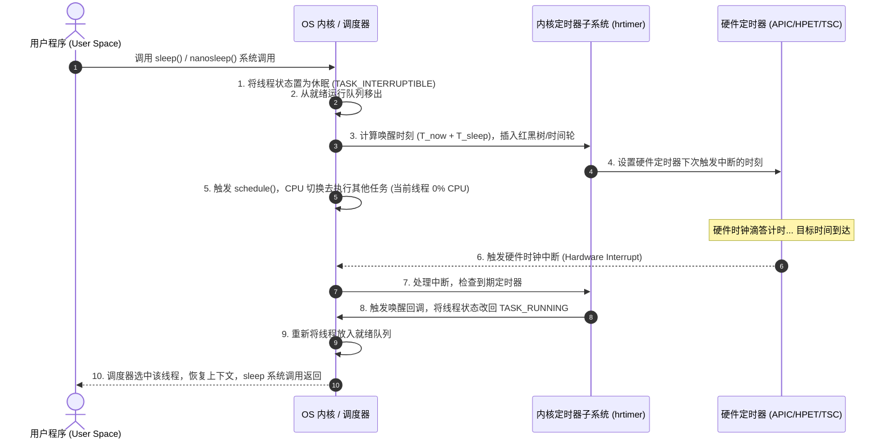

Ran command: `ls -la /Users/williamlao/.gemini/antigravity/brain/2fe4d743-5c52-4500-96de-7fbc8b6a2b63/.system_generated/logs/`
Used tool: manage_task

简而言之：**是的，主要是操作系统的内核在结合底层硬件定时器（Hardware Timer）来监督和管理 `sleep` 时间。**

而且，进程在 `sleep` 期间**完全不占用 CPU**，并不是在后台死循环“数秒”，而是直接被内核挂起并让出 CPU。

---

### 一、`sleep` 执行的全流程示意

---

### 二、底层关键环节深度剖析

#### 1. 状态切换与“0 CPU 占用”
当你调用 `sleep(5)` 时：
- 语言运行时（如 C 库、Python、Java）最终会发起系统调用（Linux 下通常是 `nanosleep` 或 `clock_nanosleep`）。
- **内核将该线程的状态从 `TASK_RUNNING`（就绪/运行态）修改为 `TASK_INTERRUPTIBLE`（可中断睡眠态）**。
- 调度器（如 Linux CFS/EEVDF）将其从 CPU 的**就绪队列（runqueue）**中移除。
- 随后内核调用 `schedule()` 发生**上下文切换（Context Switch）**，CPU 立刻去执行其他有任务的进程。
> **因此，休眠中的进程完全不消耗任何 CPU 周期。**

#### 2. 内核用什么数据结构“监督”千万个定时器？
内核中可能有成千上万个进程/定时事件都在等待超时，内核并不是开一个死循环去挨个检查，而是使用了高效的数据结构：
- **高精度定时器（`hrtimer`）**：采用**红黑树（Red-Black Tree）**。以“绝对到期时间戳”为 Key，树最左侧的节点就是**最近要到期的定时器**。
- **经典定时器（`timer_list`）**：采用**时间轮（Timer Wheel）**算法，按时间槽位以 $O(1)$ 复杂度存取。

内核只需要关心**“下一个最近会到期的时间是何时”**，并将硬件时钟设定为该时刻。

#### 3. 硬件时钟中断：真正的“物理闹钟”
内核本身也是一段运行在 CPU 上的代码，如果没有 CPU 调度它，内核也无法主动“感知”时间。
这时依赖的是**物理硬件支持**（如 x86 架构下的 Local APIC Timer、HPET、TSC，或 ARM 的 Generic Timer）：
1. 内核将最近的一个超时时间写入硬件定时器寄存器。
2. 硬件定时器独立于 CPU 指令执行在硬件层倒计时。
3. 倒计时归零时，向 CPU 针脚发送电信号，触发**硬件时钟中断（Clock Interrupt）**。
4. CPU 暂停当前正在执行的代码，保存现场，跳入内核的**中断处理函数**（ISR）。

#### 4. 唤醒与返回
1. 中断处理程序遍历到期的定时器。
2. 找到对应的休眠线程，调用唤醒函数（如 `try_to_wake_up`）。
3. 将线程状态重新置为 `TASK_RUNNING`，重新塞进调度器的就绪队列。
4. 一旦 CPU 有空闲，调度器挑中该线程，恢复它的寄存器和栈帧，`nanosleep` 系统调用执行完毕返回用户态，程序继续往下走。

---

### 三、常见疑问与延伸

| 疑问                                               | 答案与原理                                                                                                                           |
| :----------------------------------------------- | :------------------------------------------------------------------------------------------------------------------------------ |
| **`sleep(1)` 真的正好休眠 1 秒吗？**                      | **通常略大于 1 秒**。因为定时器到期只是把线程**放回就绪队列**，线程还需要等待操作系统的 CPU 调度排队、上下文切换。如果系统负载很高，可能延迟数十毫秒才被调度执行。                                       |
| **`sleep(0)` 有意义吗？**                             | 有意义。`sleep(0)` 不会设置长时间的定时器，其主要作用是**主动放弃当前时间片（Yield）**，触发一次调度让给同优先级的其他就绪线程执行。                                                    |
| **`sleep` 可以被提前打断吗？**                            | 可以。一般 `sleep` 处于 `TASK_INTERRUPTIBLE` 状态，如果进程收到了外部信号（如 `SIGINT` / Ctrl+C、`SIGTERM`），内核会立刻唤醒它并返回 `EINTR` 错误码（或剩余休眠时间），由上层决定是否重试。 |
| **异步编程（如 `asyncio.sleep` / `setTimeout`）也是这样吗？** | 机制类似但层级不同。异步框架通常在用户态单线程内用**小顶堆/时间轮**管理定时器，然后利用 `epoll_wait(timeout)` / `kqueue` / `timerfd` 把最近的超时时间一次性交给内核去监听。                 |

# 原来如此，之前一直好奇的是底层交给内核去监督，cpu依然有很大压力，原来是有个时钟硬件去执行

- ? 原来如此，之前一直好奇的是底层交给内核去监督，cpu依然有很大压力，原来是有个时钟硬件去执行

您抓住了最核心的本质！**“中断驱动（Interrupt-Driven）”代替“轮询（Polling）”** 是现代计算机体系结构中最核心的设计之一。

如果让 CPU 软件层面去一直查表计算时间，CPU 确实会满载空转（100% 占用并剧烈发热发烫）。引入硬件定时器之后，整个体系变得极其优雅：

---

### 进一步思考：如果系统里**所有进程**都在 `sleep`，CPU 会怎样？

很多人以为此时 CPU 会以 100% 算力不停空转，但实际上 CPU 会**连自己也一起“睡过去”**：

#### 1. 挂起指令（`HLT` / `WFI`）
- 当调度器发现没有任何可运行的进程时，它会切换到内核的 **空闲任务（Idle Task，PID 0）**。
- `Idle` 任务只做一件事：向 CPU 发送一条底层休眠指令，比如 x86 架构的 **`HLT` (Halt)** 或 ARM 架构的 **`WFI` (Wait For Interrupt)**。
- 这条指令会直接让 CPU 核心**停止执行指令流水线，关闭部分内部时钟信号**，进入低功耗状态（C-States）。

#### 2. 硬件电信号唤醒
- 此时 CPU 核心是完全“静止”的。
- 只有主板/核心自带的**硬件定时器倒计时归零**，产生一个物理电脉冲（硬件中断信号），或者你**敲击了键盘/移动了鼠标**（外设中断），CPU 核心才会像被闹钟按了开关一样瞬间通电苏醒，去执行中断处理函数。

#### 3. 现代操作系统的“无滴答内核”（Tickless / NO_HZ）
- **过去的老系统**：硬件定时器每秒固定触发几十到上千次中断（比如固定 1000Hz 周期性滴答），哪怕系统全在睡觉，CPU 每秒也要被无意义地唤醒 1000 次。
- **现在的现代系统（Linux / macOS / Windows）**：采用 **Tickless 机制（`NO_HZ`）**。如果有进程 `sleep(10)`，而期间没有其他任何任务，内核会把硬件定时器直接设定在 **10 秒之后**。在整整 10 秒之内，**一次中断都不会发生**，CPU 核心可以进入深度睡眠（如 C6/C7 状态），功耗降低到几乎为 0（这就是笔记本为什么合盖或待机能待机几十天不耗电的原因）。

---

### 总结
这就是为什么：
1. **进程层**：通过操作系统**状态机转换**（移出就绪队列），让进程 0% CPU 占用；
2. **内核与硬件层**：通过**硬件定时器 + 中断机制**，避免内核轮询；
3. **物理层**：通过 **CPU 硬件休眠指令（`HLT`）**，让 CPU 在没事干时连自己也休眠。

层层解耦，完全由硬件事件驱动，保证了极低的开销与能耗。