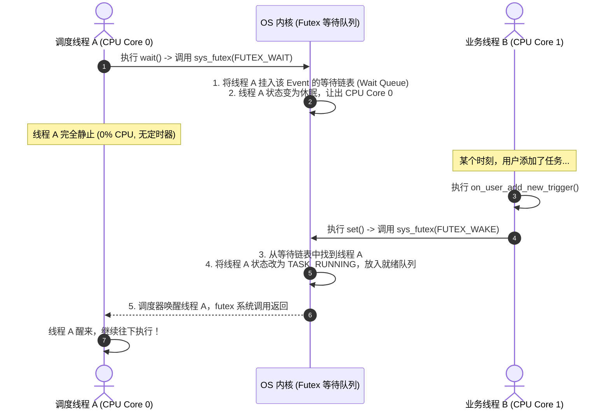

# wait和唤醒

这个问题问到了并发编程和操作系统最精妙的核心：**如果一个线程无限期挂起（没有定时器），它到底是被谁、以什么方式唤醒的？**

简短回答：**它是被“另一个正在执行代码的线程”通过系统调用主动叫醒的。**

整个过程不需要时钟定时器，而是依靠内核的 **等待队列（Wait Queue / Futex）** 以及 CPU 的 **核间中断（IPI）**。

---

### 一、生活中的比喻：酒店的前台与留言簿

1. **线程 A（执行 `wait()` 的调度器）**：
   - 走到酒店前台（操作系统内核），在留言簿（**等待队列**）上写下自己的名字：“如果有人触发了 `_wake_up_event`，请叫醒我”。
   - 然后回房间关灯睡觉（CPU 将其设为 `TASK_INTERRUPTIBLE`，移出就绪队列）。
   - **因为没有设闹钟，所以没有任何硬件定时器在倒计时。**

2. **线程 B（处理用户请求，执行 `on_user_add_new_trigger`）**：
   - 线程 B 正在某个 CPU 核心上**真实运行着**（正在跑 Python 代码）。
   - 线程 B 执行到 `_wake_up_event.set()`。
   - 线程 B 发起系统调用，走到前台对内核说：“帮我看一下留言簿，把等 `_wake_up_event` 的人都叫醒！”

3. **内核前台**：
   - 翻开等待队列，找到了线程 A。
   - 把线程 A 的状态改回 `TASK_RUNNING`，重新塞进 CPU 的可运行队列。

---

### 二、底层硬核实现：从 Python 到 Linux 内核与 CPU

在 Linux / POSIX 体系下，这一套机制是通过 **Futex（Fast Userspace Mutex）** 和 **等待队列（Wait Queue）** 实现的：



#### 1. 线程 A 休眠时做了什么？
当 Python 执行 `self._wake_up_event.wait()` 时：
- 底层调用了 Linux 内核的 `sys_futex(addr, FUTEX_WAIT, ...)` 系统调用。
- 内核在内存里维护着一个哈希桶，找到 `addr` 对应的 **等待队列（`wait_queue_head_t`）**。
- 内核把线程 A 的描述符（`task_struct`）做成一个节点，挂在这个链表里。
- 随后内核调用 `schedule()`，线程 A 放弃 CPU，进入睡眠。

#### 2. 线程 B 唤醒时做了什么？
当有新任务进来，线程 B 执行 `self._wake_up_event.set()` 时：
- 线程 B 在底层调用 `sys_futex(addr, FUTEX_WAKE, 1)`。
- 内核根据 `addr` 找到同一个等待队列，把链表头部的线程 A 摘下来。
- 内核调用 `try_to_wake_up(thread_A)`，将线程 A 标记为 `TASK_RUNNING`，放进调度器的就绪队列中。

---

### 三、硬件层面的精妙细节：多核 CPU 是怎么传递这个“唤醒”的？

如果 **线程 A 之前绑在 CPU 核心 0**（此时核心 0 可能因为没事干在 `HLT` 休眠），而 **线程 B 运行在 CPU 核心 1**：

1. 核心 1 上的线程 B 发起唤醒，内核发现线程 A 应该在核心 0 上跑。
2. 核心 1 会向核心 0 发送一个 **核间中断（IPI，Inter-Processor Interrupt）**——这是一个**纯硬件级的电信号**！
3. 核心 0 收到电信号后瞬间被拍醒，从 `HLT` 恢复运行，立刻执行内核调度程序，让线程 A 恢复执行。

---

### 四、再看你的核心点：`wait(timeout=wait_seconds)` 又是怎么工作的？

你的代码里最精彩的是带超时的那一行：
```python
self._wake_up_event.wait(timeout=wait_seconds)
```
这是 **“硬件定时器” 与 “线程间主动唤醒” 的完美结合（双保险赛跑）**：

1. **同时注册两件事**：
   - 在**等待队列**里登记：“如果有人 `set()`，请叫醒我”；
   - 在**硬件定时器（`hrtimer`）**里登记：“如果到了 `wait_seconds` 秒，请叫醒我”。
2. **看谁先发生（谁先到谁赢）**：
   - **情况 1（被提前打断）**：才过了 2 秒，用户加了新任务，线程 B 调用了 `set()`。
     $\to$ 线程 A 立即被线程 B 唤醒，同时内核会自动**取消并注销**那个硬件定时器。
   - **情况 2（自然超时）**：等满了 `wait_seconds` 秒也没人加任务。
     $\to$ 硬件时钟中断触发，内核的定时器回调把线程 A 从等待队列里移除并唤醒，`wait()` 返回超时。

这就是操作系统调度体系中**“事件驱动（Event-Driven）+ 超时保底（Timeout Fallback）”**的标准范式！

# epoll 的层级

你的理解已经完全切中了现代操作系统设计的灵魂！

我们分别来解答这两个问题：

---

### 问题 1：等待队列和 epoll 是同一层级还是更底层？

**等待队列（Wait Queue）是更底层的基石，`epoll` 本身就是基于等待队列构建起来的高级子系统。**

在 Linux 内核中，几乎所有会导致线程休眠的机制（`futex`、`epoll`、`Socket`、管道 `Pipe`、磁盘读写）**底层用的全是同一个核心数据结构：`wait_queue_head_t`（等待队列头）**。

#### 它们的分层关系如下：

```
+-------------------------------------------------------------+
| 上层应用 / 语言 (Python asyncio, Nginx, Node.js, Go runtime) |
+-------------------------------------------------------------+
                              ↓ (调用系统调用)
+-------------------------------------------------------------+
| 内核高级多路复用机制: epoll / futex (Event, Lock) / 信号量    |
+-------------------------------------------------------------+
                              ↓ (底层全部依赖)
+-------------------------------------------------------------+
| 内核最基础构件: 等待队列 (Wait Queue) + 调度器就绪队列 (Runqueue)|
+-------------------------------------------------------------+
                              ↓ (物理驱动)
+-------------------------------------------------------------+
| 硬件层: CPU 核心 / 网卡中断 / 时钟中断 / 磁盘中断              |
+-------------------------------------------------------------+
```

#### `epoll` 是如何利用“等待队列”的？
当你把 10 万个 Socket 扔给 `epoll` 时：
1. **注册（`epoll_ctl`）**：每个 Socket 内部都有一个内核等待队列（`sk_sleep`）。`epoll` 会在每一个 Socket 的等待队列里，悄悄挂上一个**回调函数（`ep_poll_callback`）**。
2. **硬件触发**：当某个 Socket 收到网卡数据，网卡中断触发，内核调用该 Socket 等待队列里的回调。
3. **放入就绪链表**：回调函数执行，把这个有数据的 Socket 扔进 `epoll` 专用的 **就绪双向链表（`rdllist`）** 中。
4. **唤醒用户线程**：如果你的线程正在 `epoll_wait()` 休眠，`epoll` 自身也是一个等待队列，它会顺手把你的线程唤醒！

> **结论**：等待队列是 Linux 内核中用于“让线程睡觉与叫醒”的最基本原语；`epoll` 是巧妙利用等待队列的回调机制，专门用来管理海量网络连接的“大管家”。

---

### 问题 2：内核原来从不主动“巡逻”遍历等待队列？

**完全正确！这是理解操作系统运行机制最关键的一个分水岭。**

很多人初学时会潜意识里认为：“内核是一个一直在后台跑着死循环、到处巡逻检查的幽灵程序”。**但实际上，内核绝对不会没事去循环遍历成千上万的等待队列。** 

如果内核去轮询（Polling），CPU 就会被无休止的“巡逻”跑满 100%，耗电极快。

现代操作系统是**纯粹的“事件驱动（Event-Driven / Push）”架构**：**谁产生改变，谁在自己的执行流程里“顺手”去唤醒别人。**

---

### 整个操作系统中，唤醒沉睡线程的“推动力”只有这三种：

只要一个线程睡着了，**世界上只有 3 类执行上下文**能把它叫醒：

| 唤醒源 | 谁在占用 CPU 执行代码？ | 是怎么叫醒的？ |
| :--- | :--- | :--- |
| **1. 线程间通信<br/>（如你的 `event.set()`）** | **另一个活着的业务线程**（正在 CPU 上跑用户代码，随后发起系统调用） | 该线程执行 `set()` $\to$ 陷入内核 `sys_futex(WAKE)` $\to$ **直接根据内存地址精准找到对应的等待队列**，摘下目标线程唤醒。 |
| **2. 硬件 I/O 到达<br/>（如网卡、键盘、磁盘）** | **硬件中断处理程序（Interrupt Handler）** | 网卡收到数据包 $\to$ 触发 CPU 电信号中断 $\to$ CPU 暂停手头工作执行网卡驱动 $\to$ 驱动将数据放入 Buffer，**顺手调用 `wake_up()` 唤醒等数据的进程**。 |
| **3. 时间超时<br/>（如 `sleep(5)` 或 `wait(timeout=3)`）** | **时钟硬件中断处理程序** | 物理时钟倒计时归零 $\to$ 触发 CPU 时钟中断 $\to$ 中断代码检查定时器红黑树最左侧的到期任务，**顺手调用唤醒函数**。 |

---

### 核心心智模型总结

> **内核本身不是一个拥有独立意志的“进程”。**
>
> 内核只是一堆被放在内存高地址的代码库（一组函数）。它只有在两种情况下被执行：
> 1. **有进程调用了系统调用（借用当前进程的 CPU 执行内核代码）**；
> 2. **有外部硬件触发了中断（CPU 被强行拉去执行中断处理函数）**。
>
> 永远是**“正在 CPU 上跑代码的人（无论是普通线程还是中断代码）”，去等待队列里拉一把“睡着的人”**，绝不存在第三方的“常驻巡逻程序”。