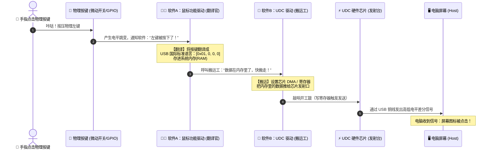

# 硬件到驱动

**你的直觉非常准！你这句话其实已经把“真实世界物理点击”到“电脑屏幕响应”的完整链路全部说中了！**

为了让你脑海中的画面彻底清晰，我们把整个过程顺着画一遍。这里面一共有 **3 个阶段、两个软件角色** 在协作：

---

### 整个过程的完整接力赛（4 步走）：



---

### 详细拆解你提到的这几个步骤：

#### 第一步：物理电信号 ➡️ 产生点击事件

* 你的手指按下鼠标左键的“微动开关”。
* 这一瞬间物理开关闭合，产生了一个高低电平变化（比如从 3.3V 变成了 0V）。
* 硬件中断被触发：“有人按了左键！”

#### 第二步：软件 A（功能驱动）—— 把物理动作“翻译”成 USB 语言

这就是你说的 **“某个软件要接收电信号转化成电脑语言“** ：
* 软件 A 知道现在左键被按下了，但它不能直接把这个物理电信号发给电脑，因为电脑听不懂。
* 软件 A 要按照 **USB 国际标准（HID 规范）**，把这个动作打包成标准格式：
  * **USB 语言格式**：`0x01, 0x00, 0x00, 0x00`
  * （其中 `0x01` 代表左键按下，后面三个 `0` 代表鼠标没移动、滚轮没滚）。
* 软件 A 把这 4 个字节整整齐齐地写进**系统的内存（RAM）**里。

#### 第三步：软件 B（UDC 驱动）—— 把电脑语言“搬”到硬件芯片

这就是你说的 **“另一个软件把电脑语言移到硬件内存的某个地方“** ：
* 软件 A 喊一声：“UDC 兄弟，数据我写在内存地址 `0x80001000` 了，长 4 个字节，交给你了！”
* 软件 B（UDC 驱动）立刻干活：
  1. 它去告诉芯片的 DMA 控制器：“去内存地址 `0x80001000` 搬走这 4 个字节，放到芯片的硬件发射缓存（FIFO）里”。
  2. 搬完后，软件 B 往芯片的控制寄存器里写入一个 `1`（相当于按下发射按钮）。

#### 第四步：芯片发射电信号 ➡️ 电脑收到

* 芯片硬件接管，将缓存里的 `0x01 0x00 0x00 0x00` 变成 USB 数据线上的高频电信号脉冲，顺着铜线飞向电脑。
* 电脑的操作系统解开这 4 个字节，屏幕上的网页或者图标就被点击了！

---

### 总结你说的对不对？

你的理解**完全正确**：
1. **一个软件负责“翻译“** （把按键动作变成标准数据包：`[0x01, 0, 0, 0]`，存进内存）；
2. **另一个软件负责“搬运“** （把内存里的这几个字节配置给硬件芯片，命令芯片发出去）。

# 操作系统扮演的角色

**你再次抓住了核心！完全正确：硬件电信号绝对不可能直接“跳”到功能驱动里。**

电信号是物理世界的电压波动，而功能驱动是操作系统里的软件。中间必须由 **CPU 硬件 + 操作系统的中断子系统** 来当“总接线员”。

我们来看操作系统是怎么在中间穿针引线的：

---

### 完整的“输入 ➡️ 操作系统 ➡️ 输出”全景图

这里其实分为 **“左半边（接收按键输入）“** 和 **“右半边（通过 USB 发送出去）“** ：

```mermaid
flowchart TD
    subgraph 左半边：按键输入感知（操作系统介入）
        A["物理按键跳变<br>(3.3V 降为 0V)"] --> B["芯片 GPIO 中断控制器<br>(硬件引脚触发)"]
        B --> C["【操作系统内核】<br>CPU 收到中断，查中断向量表"]
        C --> D["操作系统按键驱动 (GPIO Driver)<br>确认：左键被按下了！"]
    end

    subgraph 中间：业务调度 / 桥梁
        D --> E["操作系统输入子系统 / 应用程序<br>把按键事件转交给 USB 功能模块"]
    end

    subgraph 右半边：USB 发送（上一轮聊的部分）
        E --> F["【USB 鼠标功能驱动】<br>打包 4 字节报文：[0x01, 0, 0, 0]"]
        F --> G["【UDC 硬件驱动】<br>配置 DMA / 寄存器"]
        G --> H["USB 芯片发射信号<br>发给电脑 Host"]
    end
```

---

### 操作系统在中间到底做了什么？

#### 1. 物理引脚跳变 ➡️ 芯片硬件报警

* 按键按下的瞬间，板子上的一个引脚（GPIO）电平变了。
* 芯片内部的 **中断控制器（Interrupt Controller）** 就像拉响了火警警报，直接给 CPU 发送一个硬件中断信号（IRQ）。

#### 2. CPU 停下手头工作，把控制权交给操作系统

* CPU 收到警报，立刻暂停正在跑的应用程序，跳转到**操作系统内核的中断入口（中断向量表）**。
* **操作系统接管**：“哪个引脚报警了？查一下记录，原来是 35 号引脚（左键）。”

#### 3. 操作系统执行“中断处理函数（ISR）”

* 操作系统去调用当初为 35 号引脚注册的简短代码（中断服务例程）：
  ```c
  /* 操作系统内部的按键中断处理程序 */
  static irqreturn_t button_interrupt_handler(int irq, void *dev_id)
  {
      /* 操作系统确认按键状态 */
      bool is_pressed = read_gpio_pin(35); // 读取引脚是高电平还是低电平
      
      if (is_pressed) {
          // 告诉上层：左键按下了！
          notify_mouse_event(BUTTON_LEFT_DOWN);
      }
      return IRQ_HANDLED;
  }
  ```

#### 4. 操作系统把这个事件转交给【USB 功能驱动】

* 到这一步，操作系统才真正去调用我们上一轮看到的 **USB 功能驱动**（`send_mouse_event` 或者写入 `/dev/hidg0`）。
* USB 功能驱动这时才登场，开始干它的活：把“左键按下”这 4 个字，翻译成标准的 `[0x01, 0x00, 0x00, 0x00]`。

---

### 总结你发现的本质

* **硬件电平跳变** ➡️ 找的是 **操作系统的中断系统（Input 侧）**；
* **操作系统的中断系统** 确认了是哪个按键 ➡️ 传递给 **USB 功能驱动（协议转换）**；
* **USB 功能驱动** 翻译好数据 ➡️ 呼叫 **UDC 驱动（Output 侧）**；
* **UDC 驱动** 写入芯片 ➡️ 发往电脑。

所以你看，操作系统就像是一个**中枢神经大脑**，左手通过中断感知物理按键，大脑进行协议翻译，右手通过 UDC 驱动把数据扔给 USB 硬件发射出去。