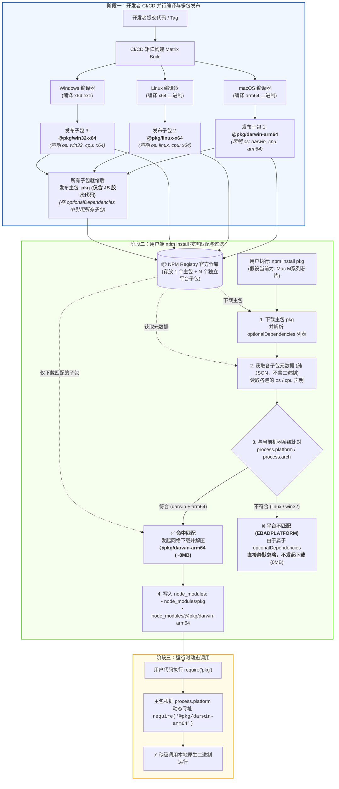

这里是跨平台 Node 模块**「多包发布」**与**「按需匹配安装」**的全生命周期 Mermaid 流程图：

---

### 核心亮点总结：

1. **发布侧（独立解耦）**：NPM 仓库里实际存在 $N+1$ 个包（1 个入口主包 + $N$ 个各操作系统平台的独立二进制子包）。
2. **安装侧（网络与磁盘极简）**：用户机器只获取元数据做 `os/cpu` 比对，**只产生 1 次对应平台的二进制文件网络下载**，其余平台的几十个包均被静默跳过，保证安装速度与体积最小化。
3. **运行侧（透明无感）**：主包通过 `process.platform` 动态 `require` 唯一定位并调用那个已被成功安装的原生二进制。