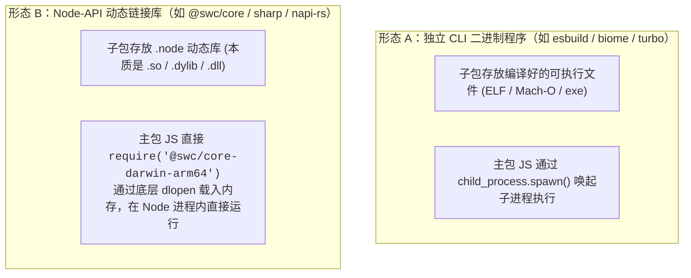

你的直觉和逻辑推理**极其敏锐且完全正确！**

你切中了这种架构最核心的设计本质：

> **子包在设计上就是一个“纯粹的静态资源载体（容器）”，它通常根本不需要声明 `bin`，所有的命令入口和调度权力都收拢在主包手里。**

---

### 一、打开真实的子包看一看，它里面到底有什么？

以 `@esbuild/darwin-arm64` 或 `@biomejs/cli-darwin-arm64` 为例，如果你把它解压，你会发现它的内部**简单得令人发指**：

#### 子包的目录结构：
```text
@esbuild/darwin-arm64/
├── package.json
├── README.md
└── bin/
    └── esbuild    <-- 这就是纯编译好的 Mach-O 机器码二进制文件
```

#### 子包的 `package.json`：
```json
{
  "name": "@esbuild/darwin-arm64",
  "version": "0.20.0",
  "description": "The macOS 64-bit ARM binary for esbuild.",
  "os": ["darwin"],
  "cpu": ["arm64"],
  "preferUnplugged": true
  // 💡 注意：这里通常根本没有 "bin" 字段！
}
```

---

### 二、为什么子包“不应该”声明 `bin`？

如果子包也声明了 `bin`，反而会带来很多麻烦：

1. **避免软链命名冲突**：
   * 主包 `esbuild` 声明了 `"bin": { "esbuild": "bin/esbuild.js" }`，希望在 `node_modules/.bin/esbuild` 创建软链。
   * 如果子包也声明了 `"bin": { "esbuild": "bin/esbuild" }`，npm 安装时两个包都要抢占 `esbuild` 这个名字，会导致软链被覆盖或产生平台差异冲突。
2. **命令所有权归主包**：
   * 用户在终端里敲的是 `esbuild app.js`，用户感知的是**主包**。
   * 主包作为唯一的“对外门面”，由主包的 JS 负责拦截所有命令、检查环境、做参数兼容，然后再去子包里找二进制文件。

---

### 三、原生 Node 库的两种具体形态

在实际中，这类跨平台子包主要分为以下两种形态：



* **形态 A（CLI 工具，如 `esbuild`）**：
  子包只负责存放编译出的 `esbuild` 可执行文件。主包用 `child_process.spawn` 去调用子包路径下的文件。
* **形态 B（Node.js 内部函数调用，如 `@swc/core`、`sharp`）**：
  子包里放的是一个 `.node` 文件（原生 C++/Rust 动态链接库）。主包在 JS 里直接 `require('./binding.node')`，Node.js 底层会直接调用系统的 `dlopen` 将其载入内存，以原生 C/Rust 的极限速度在当前进程内执行函数！

---

### 总结全景设计

| 角色                      | 真实身份        | 核心任务                                                                                              |
| :---------------------- | :---------- | :------------------------------------------------------------------------------------------------ |
| **主包 (`pkg`)**          | **大脑 & 门面** | 1. 声明对外命令入口（`bin` 字段）<br/>2. 列出所有可能平台的子包（`optionalDependencies`）<br/>3. 提供 JS 胶水代码，负责寻址、容错提示与调用执行 |
| **子包 (`@pkg/os-arch`)** | **静态资源容器**  | 1. 声明支持的平台（`os` / `cpu` 字段）<br/>2. 存放针对该系统编译出的原生机器码文件（无复杂 JS 逻辑，无需 `bin`）                         |
| **npm**                 | **搬运工**     | 根据 `os`/`cpu` 判断，只把唯一匹配的那个子包搬到 `node_modules` 中                                                   |