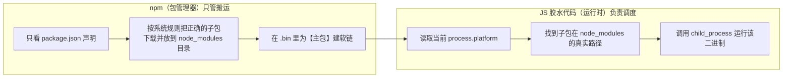

你的感觉非常准！答案是：**npm 的 `bin` 字段在技术上【可以直接指向原生二进制文件】，但在实际的工程实践中，99% 的跨平台工具都采用【`bin` 指向一个 JS 文件，由 JS 脚本去启动二进制】。**

下面为你详细解释“为什么能直接指”以及“为什么业界普遍要在中间加一层 JS 包装”。

---

### 一、技术原理：`bin` 能直接指向二进制吗？

**能。**

npm 在执行 `npm install` 时的本质行为是：
* 在 **Linux / macOS** 上：为 `bin` 字段指向的文件在 `node_modules/.bin/` 下创建一个 **符号链接（Symlink 软链）**，并赋予可执行权限（`chmod +x`）。
* 在 **Windows** 上：生成 `cmd` 和 `powershell` 包装脚本去调用目标文件。

只要目标文件是一个具备可执行格式的二进制（例如 macOS 的 Mach-O、Linux 的 ELF、Windows 的 `.exe`），系统内核就能直接识别并执行它，**并不强制要求它必须是带 `#!/usr/bin/env node` 的 JS 脚本**。

---

### 二、为什么跨平台工具几乎都用「JS 包装层」？

既然能直接指，为什么像 `esbuild`、`biome`、`turbo`、`swc` 依然选择让 `bin` 指向一段 JS 代码呢？核心有以下 **4 个致命原因**：

#### 1. 配合「多包分发架构」动态寻址
在多包架构中：
* 用户安装的是主包 `esbuild`。
* **主包自己根本没有编译好的二进制文件**，真正的二进制分散在 `@esbuild/darwin-arm64`、`@esbuild/linux-x64` 等各个子包里。
* 主包在发布时**无法预知用户会装哪个子包**，所以主包的 `package.json` 无法直接在 `bin` 字段写死一个固定的二进制路径。

👉 **解决方案**：主包的 `bin` 指向 `bin/esbuild`（一段 JS 代码），由这个 JS 在运行时根据 `process.platform` 和 `process.arch` 动态找到当前安装的子包路径并启动。

---

#### 2. 友好的错误诊断与兜底（极度重要）
如果直接指定二进制文件，一旦出现以下情况：
* 用户执行了 `npm install --no-optional`（跳过了二进制子包下载）；
* 用户处于离线/受限内网环境，子包安装失败；
* 用户的系统架构极其冷门（如 RISC-V、LoongArch）。

如果直接指向二进制，用户在终端运行命令时只会收到一句冷冰冰且无解的报错：
```bash
$ my-cli
bash: /path/node_modules/.bin/my-cli: No such file or directory
```
而有了一个 **JS 包装层**，就可以在找不到二进制时给出**非常人性化的排错提示**，甚至自动降级：
```javascript
// bin/cli.js 伪代码
const binaryPath = resolveBinary();

if (!fs.existsSync(binaryPath)) {
  console.error(`
❌ 错误：未找到适合当前系统 (${process.platform}-${process.arch}) 的原生可执行文件。
👉 可能的原因：
  1. 安装时使用了 --no-optional 参数
  2. 网络中断导致可选依赖下载失败
💡 解决建议：请尝试重新运行 npm install
  `);
  process.exit(1);
}
```

---

#### 3. Windows 平台的兼容性与转义 Bug
Windows 与 Unix 处理命令行参数、路径以及信号（Signal）的机制差异极大：
* **参数转义（Argument Escaping）**：Windows 的 `cmd.exe` 在传递带引号、空格、特殊符号（如 `^`, `&`, `%`）的参数时经常出 Bug。
* **退出码与中断信号（SIGINT/Ctrl+C）**：直接通过 npm 生成的 `.cmd` 启动 `.exe` 时，按 `Ctrl+C` 经常会出现 `Terminate batch job (Y/N)?` 挂起进程。

JS 包装层可以使用 Node.js 完善的 `child_process.spawn`，把跨平台的参数传递、标准输入输出流（`stdio: 'inherit'`）、进程退出码（`exitCode`）处理得极其丝滑和标准。

---

#### 4. 消除常驻开销（进阶黑科技）
有些同学可能会担心：“通过 JS 去启动二进制，岂不是多跑了一个 Node.js 进程，白白占用内存？”

针对这点，极致追求性能的工具链（如 `esbuild`）在 Unix 系统上会利用 Node.js 的原生扩展或系统调用 **`execvp`**：
* 找到原生二进制路径后，直接调用 `execvp` **用二进制进程彻底替换掉当前的 Node.js 进程**。
* 这样不仅启动了二进制，还**立刻销毁了 Node.js 进程**，内存开销瞬间降为 0！

---

### 三、业界标准实现方案

一个标准现代 CLI 工具的 `bin` 落地结构通常是这样的：

#### 1. 主包的 `package.json`
```json
{
  "name": "my-cli",
  "bin": {
    "my-cli": "./bin/my-cli.js" // 指向 JS 胶水脚本
  },
  "optionalDependencies": {
    "@my-cli/darwin-arm64": "1.0.0",
    "@my-cli/linux-x64": "1.0.0"
  }
}
```

#### 2. 主包的 `bin/my-cli.js`（核心胶水代码）
```javascript
#!/usr/bin/env node
const { spawnSync } = require('child_process');
const path = require('path');
const fs = require('fs');

// 1. 动态确定当前平台的子包名
const pkgName = `@my-cli/${process.platform}-${process.arch}`;

// 2. 解析二进制文件的绝对路径
let binaryPath;
try {
  const subPkgDir = path.dirname(require.resolve(`${pkgName}/package.json`));
  const exeSuffix = process.platform === 'win32' ? '.exe' : '';
  binaryPath = path.join(subPkgDir, 'bin', `my-cli${exeSuffix}`);
} catch (e) {
  console.error(`❌ 当前环境不支持或缺少平台包: ${pkgName}`);
  process.exit(1);
}

// 3. 将所有终端参数透传给底层二进制，并继承输入输出
const result = spawnSync(binaryPath, process.argv.slice(2), {
  stdio: 'inherit' // 终端颜色、交互式输入、输出全部原生穿透
});

// 4. 将二进制的真实退出码同步返回给终端
process.exit(result.status ?? 0);
```

### 总结
* **单平台/纯自用**：`bin` 可以偷懒直接写死二进制。
* **面向多平台分发与严肃工程**：**`bin` -> `JS 入口` -> `检测环境并 spawn 真实二进制`** 是目前生态中最稳健、容错率最高且体验最佳的黄金标准。

---

# node 不会自行处理子包二进制的运行

**是的，你的理解完全正确！**

Node.js 和 npm **不会**自动去识别“哪个子包对应哪个二进制并自动替你转发”。**定位子包的二进制文件并启动它，必须由开发者在主包的 JS 胶水代码中自行编写逻辑来完成。**

---

### 为什么 npm / Node 不会自动做这件事？

因为在底层的职责划分上，它们的设计是非常纯粹和解耦的：



* **npm 的视角**：它只是个“搬运工”。在 npm 看来，`@esbuild/darwin-arm64` 和 `lodash` 没有任何区别，都只是主包声明的一个依赖包而已。npm 的任务在把文件解压到 `node_modules`、并在 `node_modules/.bin` 建好主包的软链之后就彻底结束了。
* **Node.js 的视角**：它只是个“执行器”。用户输入命令后，Node.js 启动主包指定的那个 `cli.js` 脚本，至于这个脚本接下来要打印文字、计算数据，还是去调用硬盘上的某个二进制程序，Node.js 完全不过问。

因此，**主包和子包之间的这道桥梁，必须由代码显式连通。**

---

### 实际开发中，每次都要自己手写这套 JS 胶水吗？

虽然原理上需要自己写，但在现代工程实践中，**大部分框架已经把这套 JS 胶水和发布脚本完全做成了自动化工具**：

如果你用 **Rust / C++** 编写高性能 Node 工具，目前业界最顶级的框架是 **[napi-rs](https://napi.rs/)**（SWC、Turbopack、Prisma 等都在使用）：

1. 你只需要用 Rust 写好业务逻辑。
2. 运行 `napi prepublish` 或使用它提供的 GitHub Actions 模版。
3. **它会自动生成：**
   * 各个平台的子包目录和 `package.json`；
   * 主包的 `package.json`（自动填好所有的 `optionalDependencies`）；
   * **自动生成上述的所有 JS 胶水代码**（包含平台检测、动态加载、错误提示、fallback 兜底等）。

---

### 总结全链路闭环

1. **发布阶段**：CI 交叉编译出 N 个平台的二进制，发布 N 个子包 + 1 个主包。
2. **安装阶段（npm 负责）**：npm 根据 `os/cpu` 规则，只把**当前系统专属的子包**搬到用户的 `node_modules` 硬盘里。
3. **运行阶段（JS 胶水负责）**：用户敲下命令，主包的 JS 胶水代码根据 `process.platform` 找到刚才被搬进来的子包二进制，把它 `spawn` 跑起来。