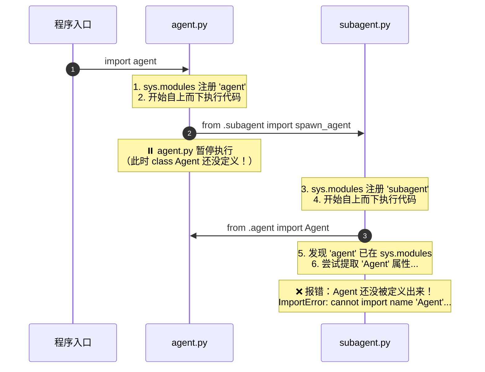

# 示例

这个错误是 Python 中最经典的 **循环导入（Circular Import / 循环依赖）** 错误。

完整错误信息通常类似于：
```text
ImportError: cannot import name 'Agent' from partially initialized module '...' (most likely due to a circular import)
```

---

### 一、 错误原因与底层机制

`partially initialized module`（部分初始化的模块）是指：Python 在执行 `import` 时，**模块已经被创建并放入了缓存列表（`sys.modules`），但该模块的代码还没有执行完毕**。

#### 触发过程示意：


1. 模块 `agent.py` 在顶部导入了 `subagent.py`；
2. Python 暂停 `agent.py`，转去执行 `subagent.py`；
3. 如果 `subagent.py` 顶部也写了 `from .agent import Agent`，Python 会直接去读取 `agent.py` 的命名空间；
4. 但此时 `agent.py` 还没执行到 `class Agent:` 这一行，命名空间中根本找不到 `Agent`，于是抛出异常。

---

### 二、 在当前项目（Wright）中的体现

在本项目 [Wright](file:///Users/williamlao/Project/wright) 中，[`Agent`](file:///Users/williamlao/Project/wright/src/wright/agent.py#L28) 是核心驱动类，同时 [`subagent.py`](file:///Users/williamlao/Project/wright/src/wright/subagent.py) 又需要派生子 Agent 实例。

为了防止这种循环导入，在 [subagent.py:L264](file:///Users/williamlao/Project/wright/src/wright/subagent.py#L264) 中，代码特意没有在文件顶部导入，而是采用了**函数内部延迟导入**：

```python
# src/wright/subagent.py
def spawn_agent(...):
    ...
    # 局部导入，避开顶部与 agent.py 的循环引用
    from .agent import Agent

    child_agent = Agent(...)
```

如果在重构或新增模块（如 `tools`、`autonomy`、`tasks`）时，直接在文件顶层写了 `from wright.agent import Agent`，或者通过 `__init__.py` 相互穿透引用，就会重新引发这个错误。

---

### 三、 常见解决与排查方案

#### 方案 1：局部延迟导入（Lazy Import，推荐应急与轻量解耦）
将 `import` 语句移到真正调用它的函数/方法内部，确保此时各模块顶层代码都已加载完毕：
```python
def create_subagent():
    from .agent import Agent  # 延迟到执行时导入
    return Agent(...)
```

#### 方案 2：仅用于类型提示时使用 `TYPE_CHECKING`
如果导入 `Agent` 仅仅是为了类型注解（Type Hinting），使用 `typing.TYPE_CHECKING`：
```python
from __future__ import annotations
from typing import TYPE_CHECKING

if TYPE_CHECKING:
    from .agent import Agent  # 运行时不导入，仅静态类型检查器生效

def register_listener(agent: Agent) -> None:
    ...
```

#### 方案 3：导入模块而非具体类（Module Import）
改为导入模块名，运行时通过属性访问：
```python
from . import agent  # 导入模块本身

def do_something():
    obj = agent.Agent(...)  # 使用时再读取属性
```

#### 方案 4：提取协议与接口（架构级解耦）
如果多个模块强耦合，将公共的数据结构、抽象基类或 Protocol 抽离到独立模块（如 `types.py`、`protocol.py` 或 `interfaces.py`），让底层和高层模块都依赖接口，而非相互依赖具体实现。

# 不同归因的解决方案

简短的回答是：**从“架构纯洁性”的角度来看，方案 4 确实是唯一从根本上消除环形依赖的“根治”方案；但在真实的 Python 工程实践中，方案 1、2、3 并不是单纯的“偷懒敷衍”，而是各有其合理且不可替代的应用场景。**

我们可以从**架构设计**与**工程实用主义**两个维度来剖析：

---

### 一、为什么说方案 4 是“架构层面的根治”？

在软件设计原则中，模块之间的依赖关系应该是 **有向无环图（DAG）**。

当出现 `A 依赖 B，B 又依赖 A` 时，本质上暴露了**设计上的职责不清（双向耦合）**：
* 为什么 `subagent`（底层执行单元）需要知道 `Agent`（顶层调度器）的具体实现？
* 为什么底层不能只暴露一个抽象接口/协议，由外层进行装配？

```mermaid
graph TD
    subgraph 🔴 存在环形依赖（双向耦合）
        A1[Agent 核心调度] -->|引用具体实现| B1[SubAgent 子任务执行]
        B1 -->|反向引用具体实现| A1
    end

    subgraph 🟢 方案4：依赖倒置与解耦（有向无环图 DAG）
        A2[Agent 核心调度] -->|实现| P[IAgentProtocol / AgentContext 抽象协议]
        B2[SubAgent 子任务执行] -->|仅依赖| P
        A2 -->|调度| B2
    end
```

#### 方案 4 根治带来的好处：
1. **单向数据流/依赖流**：各层边界极其清晰，底层可以完全独立进行单元测试（无需把庞大的上层引擎全部 import 进来）。
2. **消除了导入时序隐患**：彻底不用担心哪天调换了文件的 import 顺序导致程序莫名崩溃。

---

### 二、既然方案 4 最好，为什么 Python 社区还大量使用方案 1、2、3？

因为在实际开发中，**盲目追求“绝对解耦”往往会带来过度设计（Over-engineering）和开发成本的激增**。

#### 1. 方案 2 (`TYPE_CHECKING`)：类型注解的最佳实践（不是妥协，是标准）
如果模块 B 只是为了在函数参数上标注 `def run(agent: Agent)`，它在**运行时根本不需要真正加载 `agent.py` 的字节码**。
* Python 官方专门引入了 `typing.TYPE_CHECKING` 和 `from __future__ import annotations`。
* **结论**：类型标注导致的循环，**方案 2 就是官方推荐的标准解法**，完全不需要为了类型注解去凭空抽出一堆抽象基类。

#### 2. 方案 1（延迟导入 / 局部导入）：性能与按需加载的关键手段
在以下工业级场景中，延迟导入是**正向设计**：
* **CLI / 启动性能优化**：如果顶层把重型第三方库（如 `torch`、`pandas`、`playwright`）全 import 进来，CLI 启动可能需要 2~3 秒；在执行具体命令的函数里才局部 import，启动时间可以降到 50ms。
* **可选依赖（Optional Dependencies）**：比如知识库检索模块，只有用户安装了扩展包并在配置中开启时才动态导入。
* **子 Agent 递归派生**：如 [subagent.py:L264](file:///Users/williamlao/Project/wright/src/wright/subagent.py#L264)，子 Agent 本身就是由 `Agent` 在运行阶段按需派生出来的，在工厂函数内部导入是极其轻量且可控的。

#### 3. 方案 3（导入模块而非属性）：降低耦合粒度
写 `import wright.agent as agent_mod` 然后在需要时取 `agent_mod.Agent`，利用了 Python 模块对象的命名空间机制。对于很多大型框架（如 Django、PyTorch），内部同级子模块之间经常采用这种方式避免局部符号未初始化的顺序问题。

---

### 三、工程选型决策矩阵

在面对 `cannot import name ... from partially initialized module` 时，可以按照下表做判断：

| 触发原因 | 推荐方案 | 评级 | 决策理由 |
| :--- | :--- | :---: | :--- |
| **仅因为类型提示（Type Hints）** | **方案 2 (`TYPE_CHECKING`)** | 🌟🌟🌟🌟🌟 | 最标准、最地道，不产生运行时开销。 |
| **模块层级颠倒（底层反向依赖顶层引擎）** | **方案 4（抽离协议/依赖倒置）** | 🌟🌟🌟🌟🌟 | **必须根治**。这是典型的架构坏味道，应该把接口/数据结构沉淀到 `types.py` 或 `protocol.py`。 |
| **启动性能优化 / 可选依赖 / 插件加载** | **方案 1（局部延迟导入）** | 🌟🌟🌟🌟 | 合理且高效的设计手段。 |
| **仅为解决两个紧密协作类的一处调用** | **方案 1 或 3** | 🌟🌟🌟 | 如果这两个类本就属于同一个子域且逻辑强相关，强行拆分出 3 个新文件反而是过度设计。 |

### 总结
* **“方案 4 是不是真正的解决问题？”** —— 是的，从**架构设计**上它是最干净的。
* **“但其他方案是不是错误做法？”** —— 并不是。对于类型注解，方案 2 才是标准方案；对于按需加载，方案 1 是成熟的工程实践。核心原则是：**分清是“类型层面的引用”、“运行时按需加载”，还是“架构层面的双向依赖”。**