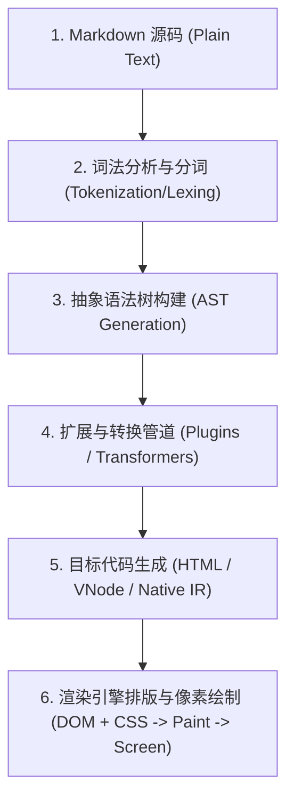
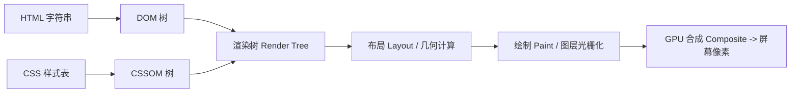
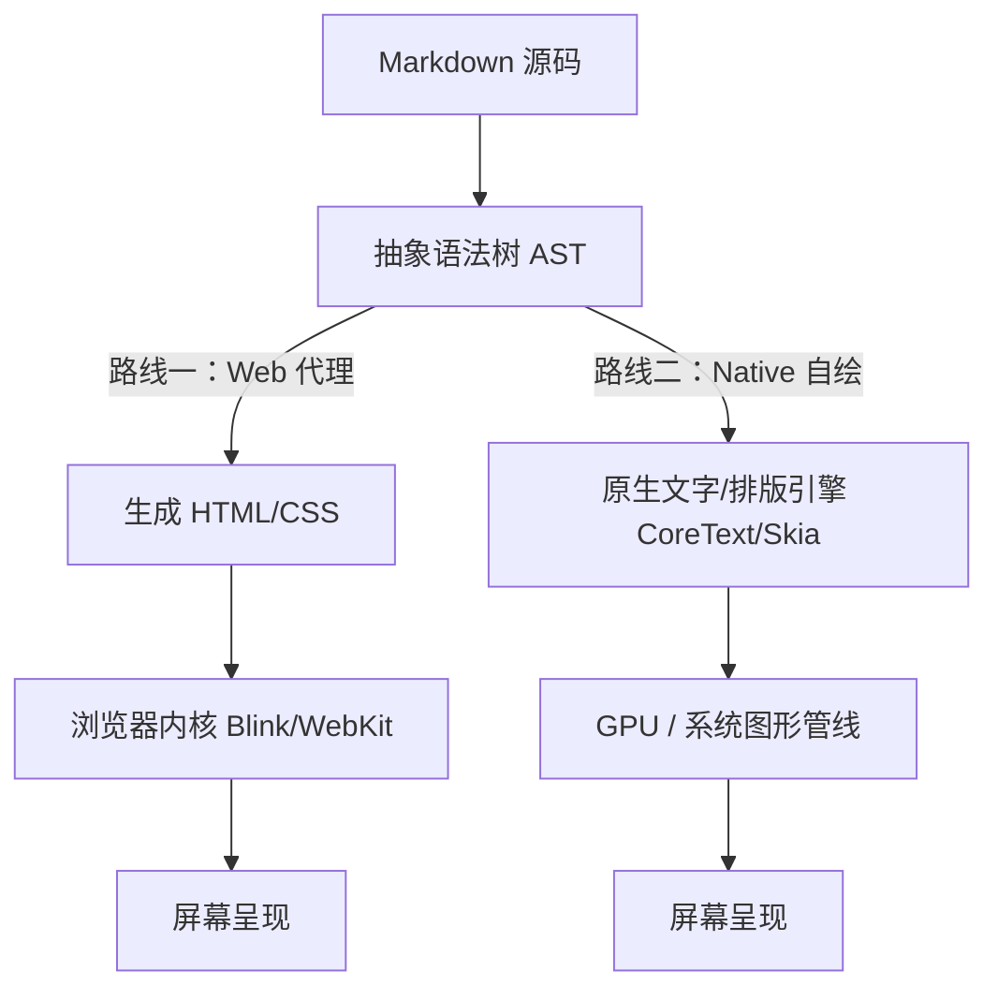
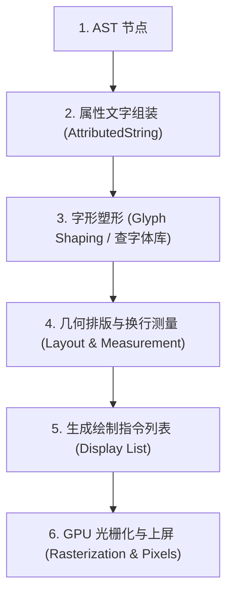

# Markdown Rendering Process - 完整对话记录

> **对话 ID**: `b9bfcafd-9dcd-49d3-a352-440aea023f70`  
> **导出时间**: `2026-09-18`

---

## 👤 User (Round 1)

我不知道markdown从源码到画面有哪些过程

---

## 🤖 Assistant (Round 1)

Markdown 从一段纯文本源码（Source Code）最终变成屏幕上看到的图文并茂的画面，本质上经历了一个典型的**编译器前端处理（解析、抽象语法树构建）**加上**图形/排版引擎后端渲染（排版、绘制、上屏）**的过程。

整个流程通常可以拆解为以下 **5 个阶段**：



---

### 第一阶段：词法分析与分词（Lexing / Tokenization）

Markdown 解析器（如 `marked.js`、`markdown-it`、`pulldown-cmark` 等）首先读取原始字符串。由于 Markdown 的语法特点，分词通常分两步：

1. **块级解析（Block Parsing）**：
   * 按照行来扫描文档，识别出文档的大结构（如标题、段落、引用块、列表、代码块、水平分割线等）。
   * 比如遇到 `# Heading`，解析器会识别出这是一个“一级标题块”。
2. **行内解析（Inline Parsing）**：
   * 在各个块的内容内部继续扫描，识别行内修饰（如 `**粗体**`、`*斜体*`、`[链接](url)`、`` `行内代码` ``、``）。
   * 解析器输出一系列平铺或初步嵌套的 **Token 序列**。

---

### 第二阶段：语法树构建（AST - Abstract Syntax Tree）

解析器将 Token 序列转化为**抽象语法树（AST）**（如 CommonMark AST 或 mdast）。语法树以树形层级结构精确表达 Markdown 的语义与层次关系。

**示例：**
```markdown
# Hello **World**
```

会被转换成类似这样的语法树结构：

```json
{
  "type": "heading",
  "depth": 1,
  "children": [
    { "type": "text", "value": "Hello " },
    {
      "type": "strong",
      "children": [
        { "type": "text", "value": "World" }
      ]
    }
  ]
}
```

---

### 第三阶段：插件与扩展处理（Transformation Pipeline）

标准的 Markdown 语法非常有限，现代应用通常在 AST 阶段接入大量插件生态（如 remark/rehype 体系）：

* **代码高亮**（Shiki / Prism / highlight.js）：遍历 `code` 节点，分析语言词法并注入着色样式标签（`<span class="token keyword">`）。
* **数学公式**（KaTeX / MathJax）：识别 `$E=mc^2$` 或 `$$...$$` 节点，转换为 MathML 或带有特殊 CSS 的排版标签。
* **图表渲染**（Mermaid）：识别 ```` ```mermaid ```` 代码块，保留配置供后续生成 SVG 矢量图形。
* **XSS 安全过滤**（Sanitizer，如 DOMPurify）：清除 Markdown 中可能夹带的恶意 `<script>` 标签或 `javascript:` 伪协议链接。

---

### 第四阶段：目标代码生成（Target Generation）

AST 经过处理后，被代码生成器（Generator/Renderer）翻译为目标环境可以直接理解的形式：

1. **Web 场景**：编译为标准 **HTML 字符串** 或前端框架的 **Virtual DOM（VNode）**。
   ```html
   <h1>Hello <strong>World</strong></h1>
   ```
2. **Native 桌面/移动端**（如 iOS Swift / Android Compose / Flutter）：
   * 不经过 HTML/Webview，直接将 AST 节点转换为原生 UI 组件树（如 `Text`, `Column`, `AttributedString`）。

---

### 第五阶段：排版引擎与像素绘制（Layout & Painting）

以常见的 Web 浏览器环境为例，HTML 到了这一步与普通网页的渲染流程完全一致：



1. **构建 DOM / CSSOM**：浏览器解析 HTML 生成 DOM 树，结合页面中的 CSS（如 GitHub Markdown CSS、深浅主题样式）生成 CSSOM 树。
2. **合并 Render Tree**：剔除不可见节点（如 `display: none`），计算每个可见节点的最终计算样式（Computed Styles）。
3. **布局（Layout / Reflow）**：计算每个元素在视口中的精确几何位置、宽度、高度与换行点。
4. **绘制与光栅化（Paint & Rasterize）**：将矢量指令、文字字形、背景色、边框转换为像素点阵（Bitmap）。
5. **图层合成（Composite & Display）**：GPU 将各个独立图层合成，最终在屏幕刷新时呈现出画面。

---

### 常见的两大渲染架构分支

| 模式 | 代表应用 | 工作机制 | 特点 |
| :--- | :--- | :--- | :--- |
| **双栏/预览型 (Web-based)** | VS Code、GitHub、常规博客 | `Markdown 文本` $\to$ `HTML` $\to$ `浏览器内核 (WebView/Chromium)` | 兼容性极强、生态丰富（可使用海量 Web 插件与 CSS 主题）。 |
| **所见即所得编辑器 (WYSIWYG)** | Typora、Obsidian、Notion | 基于富文本内核（如 ProseMirror、Lexical、CodeMirror）实时维护编辑状态与 AST | 编辑与渲染同屏合一，打字时动态替换隐藏 Markdown 标记符号。 |

---

## 👤 User (Round 2)

@[Quote] 一种是转换成html让web去处理，一种是自己去处理？

---

## 🤖 Assistant (Round 2)

**你的理解非常准确！**

从架构上看，Markdown 的渲染确实可以归结为这两大技术流派：**“委托给 Web 引擎渲染”** 与 **“自己/原生图形系统接管排版绘制”**。



---

### 路线一：交给 Web 引擎处理（“借力打力”）

把 Markdown 转为 HTML 字符串，直接扔给浏览器或应用内嵌的 WebView（如 Chromium、WebKit）去排版和绘制。

* **典型代表**：GitHub 网页、VS Code 预览面板、各大博客系统（Hexo、VuePress、Docusaurus）、绝大多数 Electron 应用。
* **怎么工作**：
  1. Markdown 解析器（`marked`, `markdown-it`）把 Markdown 变成 `<h1>`、`<p>`、`<code>`。
  2. 挂载一段现成的 CSS（如 `github-markdown.css`）。
  3. 浏览器内核全自动完成复杂的排版计算、字体降级、自动折行、图片加载和 GPU 渲染。
* **优点**：
  * **开发成本极低**：一行 `innerHTML` 就能出效果。
  * **生态极其繁荣**：天然支持海量 Web 插件（代码高亮 `Prism.js`、图表 `Mermaid.js`、数学公式 `KaTeX`）。
* **缺点**：
  * **资源消耗大**：需要拉起一个完整的浏览器内核（如 Chromium），内存占用较高。

---

### 路线二：自己/原生引擎处理（“自给自足”）

**完全不经过 HTML 和 WebView**，直接将 Markdown AST 映射为操作系统原生的 UI 组件，或者直接调用底层文字排版与图形 API 进行绘制。

* **典型代表**：
  * **Apple 原生应用**（如 Bear 熊掌记、Ulysses、Craft）：基于 macOS/iOS 底层的 `TextKit` 或 `CoreText` 引擎直接进行文字排版与字形（Glyph）光栅化。
  * **Flutter / Compose**（如 `flutter_markdown`）：直接将 AST 转为 Flutter 的 Widget 树，由底层渲染引擎（Skia / Impeller）调用 Metal/Vulkan 绘制像素。
  * **终端命令行工具**（如 `glow`、`mdcat`）：将 AST 转换为终端能够识别的 ANSI 控制字符与颜色代码，由终端模拟器直接画出文本。
* **怎么工作**：
  1. 解析 Markdown 得到 AST。
  2. 针对每个节点，开发者要**自己写排版逻辑**（例如：计算标题字号、段落行高、行间距、表格每个单元格的宽高、代码块圆角背景）。
  3. 直接向系统的 Canvas / GPU 发送绘制指令（Draw Text, Draw Rect）。
* **优点**：
  * **性能极致**：启动秒开，内存占用极小（仅几 MB 到几十 MB）。
  * **原生体验**：光标选取、原生手势缩放、系统级拼写检查与辅助功能（VoiceOver）完美贴合。
* **缺点**：
  * **开发极难**：图文混排（如文字环绕图片）、公式排版、复杂的代码着色、表格伸缩换行等，全部需要自己实现或调用复杂的底层系统排版 API。

---

### 核心对比总结

| 维度 | 路线一：Web / HTML 方案 | 路线二：Native / 自绘方案 |
| :--- | :--- | :--- |
| **渲染核心** | 浏览器内核（Blink / WebKit / Gecko） | 系统排版引擎（CoreText / DirectWrite / Skia / HarfBuzz） |
| **中间产物** | HTML + CSS | 原生组件树 / 绘制指令 / AttributedString |
| **内存/性能** | 偏重（需 Webview 运行环境） | 极轻、极快、低延迟 |
| **扩展性** | 极高（HTML/JS/CSS 生态随便用） | 较低（每个富文本扩展都需手写原生解析与绘制） |
| **典型选型** | 技术文档、博客、VS Code 插件、全平台协作工具 | 原生笔记 App（如 Bear）、高性能阅读器、移动端轻量级界面 |

---

## 👤 User (Round 3)

自己去处理从AST往下我就看不懂原理了

---

## 🤖 Assistant (Round 3)

我们用一个具体的例子，抛开所有模糊的抽象概念，一步一步看**原生引擎到底是怎么把 AST 变成屏幕上的像素点的**。

假设我们有一句极简单的 Markdown：
```markdown
> 这是 **重要** 提醒
```

此时解析器已经生成了 **AST（语法树）**：
```json
Blockquote(引用块)
 └── Paragraph(段落)
      ├── Text: "这是 "
      ├── Strong(加粗): Text: "重要"
      └── Text: " 提醒"
```

从这一步开始，原生引擎（如 iOS 的 TextKit/CoreText，或者 Flutter 的 Skia/Impeller）会经历 **5 个极其精密的物理步骤**：



---

### 第一步：属性组装（从“语义树”变成“带样式的字符串”）

原生系统不认识 Markdown 语法，但它认识 **“富文本对象”**（在 iOS/Mac 上叫 `NSAttributedString`，在 Android 上叫 `SpannedString`，在 Flutter 上叫 `TextSpan`）。

引擎会遍历 AST，把样式信息“涂”在字符区间上：

* 字符 `[0..2]`（"这是 "）：字体 = 系统默认（16px，常规体），颜色 = 灰色
* 字符 `[3..4]`（"重要"）：字体 = 系统默认（16px，**加粗体 Bold**），颜色 = 黑色
* 字符 `[5..7]`（" 提醒"）：字体 = 系统默认（16px，常规体），颜色 = 灰色
* 额外属性：左边距缩进 $20\text{px}$，左侧需要一条粗度为 $4\text{px}$ 的竖线。

---

### 第二步：字形塑形（Glyph Shaping —— 找字体的“笔画图谱”）

电脑里的文字 `'重'` 只是一个 Unicode 编码（`U+91CD`），它**不是图片**。

引擎必须拿着这个编码去字体文件（如 `.ttf`、`.otf`）里查：
1. **查字形 ID**：这个字在当前粗体字库里对应的**字形（Glyph）**编号是多少？
2. **查字形轮廓**：拿到这个字由贝塞尔曲线构成的矢量轮廓。
3. **查物理尺寸**：这个字有多宽？有多高？字与字之间需要留多少微小的间距（字距调整 Kerning）？

> **字形引擎（如 HarfBuzz、CoreText）**在这个阶段计算出：“在 16px 粗体下，‘重’字占用宽度为 $16\text{px}$，高度为 $18\text{px}$”。

---

### 第三步：几何排版与折行计算（Layout —— 像泥瓦匠一样排砖块）

现在引擎知道了每个字的尺寸，接着拿出一把**“虚拟尺子”**，结合屏幕可用的宽度（比如手机屏幕宽度 $360\text{px}$）进行空间排布：

```
屏幕宽度: 360px
| [引用竖线] (x:10, y:0, w:4, h:24)                                    |
|   缩进留白 (宽 16px)                                                  |
|   "这是" (占用宽 32px) -> 放在 (x:30, y:3)                           |
|   "重要" (加粗，占用宽 32px) -> 放在 (x:62, y:3)                     |
|   " 提醒" (占用宽 36px) -> 放在 (x:94, y:3)                          |
|   总宽度 130px < 360px，不需要换行！                                   |
```

这一步算完之后，**所有东西在屏幕上的绝对物理坐标 $(X, Y, \text{宽}, \text{高})$ 全部被确定下来了**。

---

### 第四步：生成绘制指令（Display List —— 列出作画清单）

引擎不会马上画到屏幕上，而是先生成一张**“画画任务清单”**（在图形学中叫 Draw Calls 或 Display List）：

```text
1. SetColor(RGBA: 0.8, 0.8, 0.8, 1.0)       // 设置为灰色
2. DrawRect(x: 10, y: 0, width: 4, height: 24) // 画左侧引用竖线
3. SetFont(SystemFont, 16px, Normal)
4. DrawGlyphs("这是", at: (30, 3))          // 画前两个字
5. SetFont(SystemFont, 16px, Bold)
6. DrawGlyphs("重要", at: (62, 3))          // 画加粗的两个字
7. SetFont(SystemFont, 16px, Normal)
8. DrawGlyphs(" 提醒", at: (94, 3))         // 画后两个字
```

---

### 第五步：GPU 光栅化与上屏（Rasterization —— 最终变成发光像素）

这是最后一步，CPU 把这张“作画清单”打包送给底层图形库（Metal / Vulkan / DirectX / Skia）：

1. **光栅化（Rasterization）**：把贝塞尔曲线轮廓变成屏幕上的点阵像素。
2. **像素填充**：计算每个像素的 RGB 颜色（包含抗锯齿 Subpixel Antialiasing 处理，让文字边缘看起来平滑不模糊）。
3. **显卡帧缓冲区（Framebuffer）**：将渲染好的画面数据推送到显存中。
4. **屏幕刷新**：手机或电脑屏幕以 60Hz/120Hz 的频率扫过发光二极管，你的眼睛就看到了这行排版优美的 Markdown 内容！

---

### 一句话对比核心差异

* **Web 路线**：你把 Markdown 翻译成 HTML 文本，剩下的“第一到第五步”全部由**浏览器黑盒**帮你完成。
* **原生/自绘路线**：你写代码把 AST 变成系统的 AttributedString/组件，然后由**原生系统的文字排版引擎（CoreText/TextKit/Skia）**亲自去执行这 5 个计算与绘制步骤。

---

## 👤 User (Round 4)

这5个步骤，你一步步带我走一遍，别一次性回答完，给我实际代码和操作，我自己去执行一遍试试

---

## 🤖 Assistant (Round 4)

好！我们用最直观的方式——**用一段你电脑自带的 Python 代码（macOS 默认自带 Python3），自己动手写一个极简的原生渲染内核**。

我们将分 5 步，输入同一句 Markdown：
`> 这是 **重要** 提醒`
一步一步把这个纯文本最终画成一张真正的图片文件！

---

### 第一步：从 AST 生成“带样式的属性片段”（AttributedString）

在这一阶段，我们的目标是：**遍历 AST 语法树，把层级树拍平成一段“扁平的文字”，并给每个文字打上字体、粗细、颜色等样式标签。**

#### 1. 创建代码文件

在终端中或你的编辑器里新建一个文件 `markdown_renderer.py`，粘贴以下代码：

```python
# markdown_renderer.py - 第一步：AST 转换为 AttributedString (属性文本)
import json

# 1. 假设 Markdown 解析器已经产出了这段 AST 语法树
ast = {
    "type": "blockquote",
    "children": [
        {
            "type": "paragraph",
            "children": [
                {"type": "text", "value": "这是 "},
                {"type": "strong", "children": [{"type": "text", "value": "重要"}]},
                {"type": "text", "value": " 提醒"}
            ]
        }
    ]
}

# 2. 定义我们的样式转换器
def compile_to_styled_spans(ast_node):
    """
    遍历 AST，提取所有文本片段及其对应的物理样式
    """
    spans = []
    
    # 全局容器样式（比如引用块的左侧边框、缩进）
    block_style = {
        "padding_left": 20,       # 文本距离左边的内边距 (px)
        "border_left_width": 4,   # 引用块左侧竖线的宽度 (px)
        "border_left_color": "#4A90E2" # 引用竖线的颜色（蓝色）
    }

    # 递归遍历 AST
    def traverse(node, current_style):
        node_type = node.get("type")
        
        if node_type == "blockquote":
            for child in node["children"]:
                traverse(child, current_style)
                
        elif node_type == "paragraph":
            for child in node["children"]:
                traverse(child, current_style)
                
        elif node_type == "strong":
            # 继承父级样式，但把粗细改为 bold，颜色改深
            bold_style = current_style.copy()
            bold_style["bold"] = True
            bold_style["color"] = "#E74C3C" # 加粗用醒目的红色
            for child in node["children"]:
                traverse(child, bold_style)
                
        elif node_type == "text":
            spans.append({
                "text": node["value"],
                "font_size": current_style["font_size"],
                "bold": current_style["bold"],
                "color": current_style["color"]
            })

    # 默认基础样式
    default_style = {
        "font_size": 24,
        "bold": False,
        "color": "#333333"
    }

    traverse(ast_node, default_style)
    return block_style, spans

# 执行转换
block_style, styled_spans = compile_to_styled_spans(ast)

print("=== [步骤 1 输出结果] ===")
print("【外层块级样式 BlockStyle】:")
print(json.dumps(block_style, indent=2, ensure_ascii=False))
print("\n【行内属性片段列表 StyledSpans】:")
print(json.dumps(styled_spans, indent=2, ensure_ascii=False))
```

---

#### 2. 运行并查看结果

在终端运行：
```bash
python3 markdown_renderer.py
```

#### 3. 你会看到什么？
你会看到 AST 的嵌套结构消失了，变成了一个包含 3 个元素的**扁平列表**：
1. `"这是 "`：字号 24，常规体，深灰色
2. `"重要"`：字号 24，**加粗体 (bold: true)**，**红色**
3. `" 提醒"`：字号 24，常规体，深灰色

这就是原生系统（如 iOS 的 `NSAttributedString` 或 Flutter 的 `TextSpan`）能看懂的**富文本数据结构**。

---

**你先运行一下这段代码。跑通后告诉我，我们接着进入【第二步：字形与几何尺寸测量】！**

---

## 👤 User (Round 5)

跑通了

---

## 🤖 Assistant (Round 5)

太棒了！现在我们进入 **第二步：字形测量与几何排版（Layout & Geometry）**。

---

### 第二步的目标

在第一步中，我们知道了“文字是什么”和“文字的样式”。
但计算机屏幕是一个由像素点构成的二维网格（$X$ 轴和 $Y$ 轴）。

排版引擎在这个阶段的核心任务是：**拿着一把虚拟的“尺子”，计算出每一个字、每一条线在屏幕上的绝对物理坐标 $(X, Y, \text{宽}, \text{高})$。**

```
 坐标原点 (0, 0)
    ┌───────────────────────────────────────────────────────────> X 轴
    │
    │  (x:10, y:10)
    │   │  [引用竖线] (w:4, h:34)
    │   │
    │   │   (x:30, y:14)          (x:90, y:14)       (x:138, y:14)
    │   │   ┌──────────┐          ┌──────────┐       ┌──────────┐
    │   │   │ 这是 (宽60)│          │重要(宽48)│       │ 提醒(宽60)│
    │   │   └──────────┘          └──────────┘       └──────────┘
    │
    v Y 轴
```

---

### 1. 更新代码

用下面的代码替换你的 `markdown_renderer.py`（在第一步的基础上，增加了排版计算引擎）：

```python
# markdown_renderer.py - 第二步：字形测量与几何排版计算 (Layout Engine)
import json

# --- 沿用第一步的 AST 和样式转换器 ---
ast = {
    "type": "blockquote",
    "children": [
        {
            "type": "paragraph",
            "children": [
                {"type": "text", "value": "这是 "},
                {"type": "strong", "children": [{"type": "text", "value": "重要"}]},
                {"type": "text", "value": " 提醒"}
            ]
        }
    ]
}

def compile_to_styled_spans(ast_node):
    spans = []
    block_style = {
        "padding_left": 20,       # 文本距离左侧竖线的内边距 (px)
        "border_left_width": 4,   # 引用竖线粗细 (px)
        "border_left_color": "#4A90E2"
    }

    def traverse(node, current_style):
        node_type = node.get("type")
        if node_type == "blockquote":
            for child in node["children"]:
                traverse(child, current_style)
        elif node_type == "paragraph":
            for child in node["children"]:
                traverse(child, current_style)
        elif node_type == "strong":
            bold_style = current_style.copy()
            bold_style["bold"] = True
            bold_style["color"] = "#E74C3C" # 醒目红色
            for child in node["children"]:
                traverse(child, bold_style)
        elif node_type == "text":
            spans.append({
                "text": node["value"],
                "font_size": current_style["font_size"],
                "bold": current_style["bold"],
                "color": current_style["color"]
            })

    default_style = {"font_size": 24, "bold": False, "color": "#333333"}
    traverse(ast_node, default_style)
    return block_style, spans


# --- 【第二步核心新增】：排版测量引擎 (Layout Engine) ---

def measure_char_width(char, font_size, is_bold):
    """
    模拟底层的字形测量 (Font Metrics / Glyph Shaping)
    真实系统中会调用 CoreText / HarfBuzz 查字体库文件 (.ttf) 的贝塞尔曲线轮廓
    """
    # 中文字符宽度通常等于字号 (1em)
    if '\u4e00' <= char <= '\u9fff':
        return font_size
    # 空格或英文半角字符宽度大约是字号的一半
    elif char == ' ':
        return font_size * 0.4
    else:
        return font_size * 0.6

def compute_layout(block_style, styled_spans, start_x=10, start_y=10):
    """
    排版计算：计算每个元素在屏幕上的物理坐标盒 (Bounding Boxes)
    """
    layout_boxes = []
    
    # 游标 (Cursor)：记录当前排版到了屏幕的哪个位置
    cursor_x = start_x + block_style["border_left_width"] + block_style["padding_left"]
    cursor_y = start_y
    line_height = 34  # 单行行高 (px)

    # 1. 计算每个文本片段的几何位置
    for span in styled_spans:
        text = span["text"]
        font_size = span["font_size"]
        is_bold = span["bold"]
        
        # 逐字测量宽度并累加
        span_width = sum(measure_char_width(c, font_size, is_bold) for c in text)
        
        # 为当前文字片段生成一个带有绝对坐标的“几何盒”
        box = {
            "type": "text",
            "text": text,
            "color": span["color"],
            "font_size": font_size,
            "bold": is_bold,
            "rect": {
                "x": round(cursor_x, 1),
                "y": round(cursor_y + (line_height - font_size) / 2, 1), # 垂直居中
                "width": round(span_width, 1),
                "height": round(line_height, 1)
            }
        }
        layout_boxes.append(box)
        
        # 游标向右推进
        cursor_x += span_width

    # 2. 计算引用块左侧竖线的几何位置 (从文本的总高度反推竖线的高度)
    total_block_height = line_height
    blockquote_bar_box = {
        "type": "rect", # 矩形块
        "color": block_style["border_left_color"],
        "rect": {
            "x": start_x,
            "y": start_y,
            "width": block_style["border_left_width"],
            "height": total_block_height
        }
    }
    
    # 竖线放最前面绘制
    layout_boxes.insert(0, blockquote_bar_box)
    
    return layout_boxes

# 执行排版计算
block_style, styled_spans = compile_to_styled_spans(ast)
layout_boxes = compute_layout(block_style, styled_spans)

print("=== [步骤 2 输出结果：排版几何坐标盒 (Layout Boxes)] ===")
print(json.dumps(layout_boxes, indent=2, ensure_ascii=False))
```

---

### 2. 运行并观察

在终端再次运行：
```bash
python3 markdown_renderer.py
```

### 3. 你会观察到什么？
终端会输出一组带有精确物理坐标的 JSON 数组：
* **竖线**：放在 `(x: 10, y: 10)`，宽 `4px`，高 `34px`。
* **"这是 "**：放在 `(x: 34, y: 15)`，宽 `57.6px`。
* **"重要"**：放在 `(x: 91.6, y: 15)`，宽 `48px`。
* **" 提醒"**：放在 `(x: 139.6, y: 15)`，宽 `57.6px`。

**游标（Cursor）像排字工人的手一样，依次把文字无缝地拼接在了一起。**

---

跑通之后告诉我，我们接着进入【第三/四步：生成底层绘图指令清单（Display List）】！

---

## 👤 User (Round 6)

跑通了

---

## 🤖 Assistant (Round 6)

现在进入最关键的 **第三步与第四步：生成底层绘图指令清单（Display List）并绘制出真实画面**！

---

### 为什么需要“绘制指令清单”（Display List）？

在大型现代引擎（如 Chromium、Flutter、iOS 渲染系统）中，排版计算（CPU 计算坐标）和最终画图（GPU 涂像素）通常在**不同的线程**上工作。

排版引擎算好坐标后，不会立刻一个像素一个像素去画，而是生成一张非常简单的**“动作清单”（Display List）**交给渲染管线：
* “先拿蓝色画笔，在 $(10, 10)$ 画一个宽 4 高 34 的矩形”
* “再换 24 号常规字体、深灰画笔，在 $(34, 30)$ 写下文字‘这是 ’”
* “再换 24 号**加粗**字体、**红色**画笔，在 $(91.6, 30)$ 写下文字‘重要’”
* ……

这样，渲染引擎就能高效地把这些指令打包批量发给 GPU！

---

### 1. 更新代码

用以下完整代码替换 `markdown_renderer.py`。
这次它不仅会打印出底层的**绘图指令列表**，还会执行这些指令，在当前目录下生成一个真实的矢量图片文件 **`output.svg`**：

```python
# markdown_renderer.py - 完整版：从 AST 到生成真实画面
import json

# === 步骤 1：AST 语法树 ===
ast = {
    "type": "blockquote",
    "children": [
        {
            "type": "paragraph",
            "children": [
                {"type": "text", "value": "这是 "},
                {"type": "strong", "children": [{"type": "text", "value": "重要"}]},
                {"type": "text", "value": " 提醒"}
            ]
        }
    ]
}

# === 步骤 1 实现：AST -> 属性片段 (AttributedString) ===
def compile_to_styled_spans(ast_node):
    spans = []
    block_style = {
        "padding_left": 16,
        "border_left_width": 4,
        "border_left_color": "#3498DB" # 清爽蓝色
    }

    def traverse(node, current_style):
        node_type = node.get("type")
        if node_type == "blockquote" or node_type == "paragraph":
            for child in node["children"]:
                traverse(child, current_style)
        elif node_type == "strong":
            bold_style = current_style.copy()
            bold_style["bold"] = True
            bold_style["color"] = "#E74C3C" # 醒目红色
            for child in node["children"]:
                traverse(child, bold_style)
        elif node_type == "text":
            spans.append({
                "text": node["value"],
                "font_size": current_style["font_size"],
                "bold": current_style["bold"],
                "color": current_style["color"]
            })

    default_style = {"font_size": 22, "bold": False, "color": "#2C3E50"}
    traverse(ast_node, default_style)
    return block_style, spans


# === 步骤 2 实现：几何排版计算 (Layout Engine) ===
def measure_char_width(char, font_size, is_bold):
    if '\u4e00' <= char <= '\u9fff':
        return font_size
    elif char == ' ':
        return font_size * 0.35
    else:
        return font_size * 0.6

def compute_layout(block_style, styled_spans, start_x=20, start_y=20):
    layout_boxes = []
    cursor_x = start_x + block_style["border_left_width"] + block_style["padding_left"]
    cursor_y = start_y
    line_height = 36

    for span in styled_spans:
        text = span["text"]
        font_size = span["font_size"]
        is_bold = span["bold"]
        span_width = sum(measure_char_width(c, font_size, is_bold) for c in text)
        
        layout_boxes.append({
            "type": "text",
            "text": text,
            "color": span["color"],
            "font_size": font_size,
            "bold": is_bold,
            "rect": {
                "x": round(cursor_x, 1),
                "y": round(cursor_y, 1),
                "width": round(span_width, 1),
                "height": line_height
            }
        })
        cursor_x += span_width

    # 引用竖线条
    layout_boxes.insert(0, {
        "type": "rect",
        "color": block_style["border_left_color"],
        "rect": {
            "x": start_x,
            "y": start_y,
            "width": block_style["border_left_width"],
            "height": line_height
        }
    })
    return layout_boxes


# === 【步骤 3 核心新增】：生成底层绘制指令清单 (Display List / Draw Calls) ===
def generate_display_list(layout_boxes):
    """
    把排版盒转换成一组绝对精简的绘图动作指令
    """
    display_list = []
    
    for box in layout_boxes:
        r = box["rect"]
        if box["type"] == "rect":
            display_list.append({
                "command": "DRAW_RECT",
                "x": r["x"],
                "y": r["y"],
                "width": r["width"],
                "height": r["height"],
                "fill_color": box["color"]
            })
        elif box["type"] == "text":
            display_list.append({
                "command": "DRAW_TEXT",
                "text": box["text"],
                # 文字的基准线 Baseline 计算
                "x": r["x"],
                "y": r["y"] + box["font_size"],
                "font_size": box["font_size"],
                "font_weight": "bold" if box["bold"] else "normal",
                "fill_color": box["color"]
            })
            
    return display_list


# === 【步骤 4 核心新增】：光栅化/画笔执行 (Painter -> 输出为视觉文件) ===
def render_to_svg(display_list, filename="output.svg", width=320, height=80):
    """
    执行 Display List 中的绘图指令，输出为标准矢量图 (SVG)
    """
    svg_elements = []
    
    # 浅灰色背景画布
    svg_elements.append(f'<rect width="{width}" height="{height}" fill="#F8F9FA" rx="8" />')
    
    for cmd in display_list:
        if cmd["command"] == "DRAW_RECT":
            svg_elements.append(
                f'<rect x="{cmd["x"]}" y="{cmd["y"]}" width="{cmd["width"]}" height="{cmd["height"]}" fill="{cmd["fill_color"]}" rx="2" />'
            )
        elif cmd["command"] == "DRAW_TEXT":
            svg_elements.append(
                f'<text x="{cmd["x"]}" y="{cmd["y"]}" font-size="{cmd["font_size"]}" font-weight="{cmd["font_weight"]}" fill="{cmd["fill_color"]}" font-family="-apple-system, sans-serif">{cmd["text"]}</text>'
            )

    svg_content = f'''<svg xmlns="http://www.w3.org/2000/svg" width="{width}" height="{height}" viewBox="0 0 {width} {height}">
    {chr(10).join(svg_elements)}
</svg>'''

    with open(filename, "w", encoding="utf-8") as f:
        f.write(svg_content)
    print(f"\n🎨 [渲染完成] 画面已绘制并保存到: {filename}")


# === 整个渲染管线运行 ===
block_style, styled_spans = compile_to_styled_spans(ast)
layout_boxes = compute_layout(block_style, styled_spans)
display_list = generate_display_list(layout_boxes)

print("=== [步骤 3 输出：底层绘图指令清单 (Display List)] ===")
print(json.dumps(display_list, indent=2, ensure_ascii=False))

# 执行绘制
render_to_svg(display_list)
```

---

### 2. 运行并打开图片

在你的 Mac 终端中运行：
```bash
python3 markdown_renderer.py
```

执行成功后，直接用 Mac 系统的默认预览器打开生成的图片：
```bash
open output.svg
```

---

### 3. 回顾整个过程

当你的屏幕上弹出那个**带有蓝色引用条、黑色“这是”、红色加粗“重要”、黑色“提醒”**的画面时，你刚刚亲手实现了整个链路：

1. **AST**：`{ type: "blockquote", ... }`（语义树）
2. **属性文本**：`"这是 "` + `[加粗/红色的 "重要"]` + `" 提醒"`（样式标注）
3. **几何测量**：算出了每一个字和每一条线的 `x, y, w, h`（坐标定位）
4. **绘制指令**：`DRAW_RECT`、`DRAW_TEXT`（下发指令清单）
5. **像素渲染**：系统根据矢量指令把字画在屏幕上（呈现画面）

你现在打开 `output.svg` 看到了最终渲染出来的画面吗？有任何步骤感觉有疑问吗？

---

## 👤 User (Round 7)

只生成了绘制指令啊，然后你是手动把指令写出svg代码，GPU@[Quote]  这一步我无法看到吗，还是说这一步又是自成一套

---

## 🤖 Assistant (Round 7)

**你的敏锐度极高！你一眼看穿了计算机图形体系中最核心的“分水岭”！**

你说得完全没错：
我们写的 Python 代码只负责到**“生成绘制指令”**；而写成 SVG 交给 Mac 预览器打开，其实是把最后一步“委托”给了 macOS 系统的图形引擎。

**“GPU 光栅化与上屏”这一步，确实自成一套完全独立、极其硬核的底层图形体系（Computer Graphics）。**

---

### 一、这套底层体系的边界在哪里？

在操作系统中，整个过程被划分为两个世界：

```mermaid
graph TD
    subgraph CPU 世界：应用与排版层（我们刚才写的）
        A[Markdown 文本] --> B[AST 语法树]
        B --> C[排版与测量 Layout]
        C --> D[绘制指令清单 Display List]
    end

    subgraph GPU 与图形驱动世界：自成一套的底层体系
        D -->|交给图形库 Skia/Metal/DirectX| E["1. 矢量轮廓解析 (贝塞尔曲线)"]
        E --> F["2. 光栅化 (Rasterization: 计算每个像素的 RGB)"]
        F --> G["3. 写入显存帧缓冲区 (Framebuffer)"]
        G --> H["4. 屏幕硬件以 120Hz 读取显存 -> 发光二极管亮起"]
    end
```

不管是 Markdown 引擎、浏览器（Chrome），还是 iOS/Android 系统，**排版引擎的任务在产出“绘制指令（Display List）”后就全部结束了**。接下来的事情全部移交给了底层图形库（如 Google 的 **Skia**、苹果的 **Metal/CoreGraphics**）。

---

### 二、GPU / 光栅化这一步到底在做什么？

电脑屏幕本质上是一个**巨大的点阵棋盘**（比如你的 Mac 屏幕大概是 $2560 \times 1600$ 个发光微型灯泡）。

在这一步，显卡和光栅化器只做一件事：**把数学公式（线段、圆角、字体的贝塞尔曲线）变成一个巨大的二维像素颜色数组。**

```
显存里的真实数据（纯数字内存块）：
[
  [RGBA(255,255,255,1), RGBA(255,255,255,1), RGBA(231,76,60,1), ...],
  [RGBA(255,255,255,1), RGBA(231,76,60,1),   RGBA(231,76,60,1), ...],
  ...
]
```

---

### 三、我们能不能“亲眼看到”光栅化后的像素？

**完全可以！** 我们可以写一段代码，**绕过所有浏览器和系统查看器**，直接在终端里把光栅化器在内存里算出的**每一个物理像素点阵**打印出来。

#### 动手实验：亲眼看一个文字是如何被“光栅化”为像素矩阵的

新建一个脚本 `rasterize_demo.py`，粘贴并运行：

```python
# rasterize_demo.py - 模拟 GPU/光栅化器：将文字矢量轮廓变成像素点阵
import os

def simple_rasterize_char():
    # 模拟一个 16x16 的像素缓冲区 (Framebuffer)，初始全为 0 (白色/空白)
    width, height = 24, 16
    framebuffer = [[0 for _ in range(width)] for _ in range(height)]
    
    # 模拟光栅化器计算数学几何线条覆盖的像素点 (这里以简化的加粗中文字形骨架为例)
    # 比如在显存矩阵中点亮某些像素点 (0 = 没颜色，255 = 完全着色，1~254 = 抗锯齿边缘)
    # 下面硬编码一段类似“重”字笔画的光栅化权重矩阵：
    strokes = [
        # 一横
        [(y, x, 255) for y in [2] for x in range(4, 20)],
        # 中间竖
        [(y, x, 255) for y in range(2, 14) for x in [11, 12]],
        # 内部日字结构
        [(y, x, 255) for y in [5, 9] for x in range(6, 18)],
        [(y, x, 255) for y in range(5, 10) for x in [6, 17]],
        # 底下一长横
        [(y, x, 255) for y in [13] for x in range(2, 22)],
    ]
    
    for stroke in strokes:
        for y, x, val in stroke:
            framebuffer[y][x] = val

    print("=== [底层显存视角：内存中的纯数字像素矩阵 Framebuffer (0~255)] ===")
    for row in framebuffer[1:15]:
        print(" ".join(f"{val:3}" if val > 0 else "  ." for val in row))

    print("\n=== [屏幕硬件视角：物理像素发光 (红色文字)] ===")
    for row in framebuffer[1:15]:
        line = ""
        for val in row:
            if val == 255:
                # 用 ANSI 红色色块表示发光的 OLED 像素点
                line += "\033[41m  \033[0m"
            else:
                line += "  " # 黑色/空白未点亮像素
        print(line)

if __name__ == "__main__":
    simple_rasterize_char()
```

#### 运行命令：
```bash
python3 rasterize_demo.py
```

---

### 运行后你会看到什么？

1. **第一部分（显存视角）**：你会看到计算机内存里储存的不是字，而是一个个 `255` 和 `0` 的**数字矩阵**（这就是帧缓冲区 Framebuffer）。
2. **第二部分（屏幕视角）**：终端利用发光背景色块，把这些数字矩阵还原成了你眼睛看到的“文字笔画”！

### 总结

* **Markdown 引擎的职责**：负责高层逻辑（语法、样式、布局），把纯文本变成**几何坐标与绘制指令**。
* **GPU / 图形管线的职责**：负责底层算力，把**指令中的几何形状翻译成千万个发光像素点**。

---
