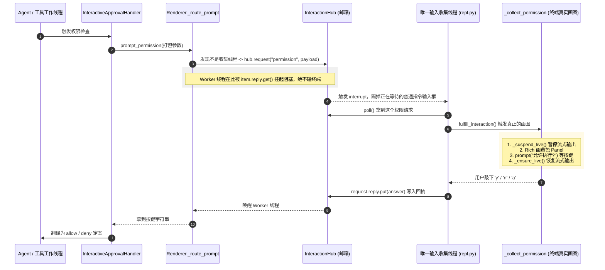

Viewed interaction.py:70-140
Viewed repl.py:1-60

Grok 点出了这套系统最核心、最硬核的**工程底色**。

之所以你在看代码时会觉得绕，正是因为：**`InteractiveApprovalHandler` 和 `prompt_permission` 本身根本不画界面，也不读终端。**

在终端应用中，有一个最致命的痛点：**标准输入 `stdin` 只能有一个读者，且流式打字输出（Live Stream）和键盘输入不能同时抢屏幕**。

为了解决这个问题，整个系统被设计成了一套**“跨线程投递的交互邮箱系统”**。我们重新沿着真实的线程和代码执行链路，把这一过程彻底梳理一遍：

---

### 核心全景：双线程与交互邮箱（InteractionHub）

整个程序在运行时主要有两个关键线程：
1. **Agent / 工具执行线程**：负责跑大模型推理、执行工具。
2. **唯一的主输入收集线程**（在 [`repl.py`](file:///Users/williamlao/Project/wright/src/wright/repl.py#L18-L27) 中启动）：**全系统唯一允许读取键盘 `stdin` 的线程**。

它们之间的完整交互链路如下：



---

### 逐步拆解关键代码细节

#### 1. `prompt_permission` 为什么只做路由？
在 [`src/wright/renderer.py`](file:///Users/williamlao/Project/wright/src/wright/renderer.py#L627-L648) 中：
```python
def prompt_permission(self, ...) -> str:
    payload = { "tool_name": tool_name, "subject": subject, ... }
    # 它只负责把参数打成字典，交给 _route_prompt
    return self._route_prompt("permission", payload, self._collect_permission)

def _route_prompt(self, kind, payload, local):
    hub = self._hub
    # 如果当前就在唯一的收集线程，直接原地画图；
    # 如果是在 Agent 工作线程，则投递给 Hub 并等待！
    if hub is not None and not hub.is_collector_thread():
        return hub.request(kind, payload)
    return local(**payload)
```

#### 2. `InteractionHub.request()` 怎么把权限弹窗“抢”到前台？
在 [`src/wright/interaction.py`](file:///Users/williamlao/Project/wright/src/wright/interaction.py#L70-L87) 中：
```python
def request(self, kind: InteractionKind, payload: dict[str, Any]) -> Any:
    item = InteractionRequest(kind=kind, payload=payload)
    with self._lock:
        self._pending.append(item)
        self._requests[item.request_id] = item
    
    # 核心动作：如果此时用户正停在主输入框打算敲下一句提示词，
    # 立刻触发 interrupt() 把主输入框踢出来（退出），让位给权限询问！
    if self._interrupt is not None:
        self._interrupt()
    
    # 工作线程在此死等回执，直到收集线程把答案 put 进来
    return item.reply.get()
```

#### 3. 收集线程的主循环（[`repl.py`](file:///Users/williamlao/Project/wright/src/wright/repl.py#L33-L47)）
收集线程是一个死循环，它的工作逻辑是：
```python
while True:
    # 1. 优先查邮箱：有没有工作线程发来的权限请求？
    request = hub.poll()
    if request is not None:
        renderer.fulfill_interaction(request) # 去画权限弹窗
        continue

    # 2. 如果没有权限请求，但 Agent 正在忙（比如在生成代码），那就等待，不画主输入框
    if not agent_idle.is_set():
        hub.wait_for_idle_or_request(agent_idle)
        continue

    # 3. Agent 彻底空闲了，才画出日常的「你的指令 > 」输入框
    value = renderer.prompt_main_input(prompt_session)
    if value is PROMPT_INTERRUPTED: # 如果被刚才的权限请求打断了，直接跳过进入下一轮循环去 poll
        continue
```

#### 4. 真正负责画画的 [`_collect_permission`](file:///Users/williamlao/Project/wright/src/wright/renderer.py#L663-L717)
这才是最终在终端画出界面的地方，它有非常严密的**防花屏措施**：
1. **`_suspend_live()`**：**先把正在屏幕上流式打字的 Live 渲染暂停**（否则模型一边吐字，弹窗一边画，终端会彻底撕裂乱码）；
2. **`Rich Panel`**：打印黄色的警告卡片（显示工具、参数、风险原因）；
3. **`prompt_toolkit.prompt("允许执行? ")`**：阻塞等待用户敲击 `y` / `n` / `a`；
4. **`finally: _ensure_live()`**：无论用户怎么输入、或者发生什么异常，**必定把 Live 渲染拉回来**；
5. 把答案通过 `request.reply.put(answer)` 发回给阻塞的 Agent 线程。

---

### 为什么要设计得这么深？换终端不用改一行权限代码

这样设计之后，系统获得了一个巨大的架构优势：**前端 UI 完全解耦**。

- **经典 CLI 终端（REPL）**：
  收集端使用 `ConsoleRenderer`（Rich Panel + 终端 prompt）。
- **全屏工作台（TUI / Textual 模式）**：
  同一套 `InteractionHub`，收集端直接换成 [`TUIRenderer`](file:///Users/williamlao/Project/wright/src/wright/tui/renderer.py#L218)，当收到请求时弹出一个带按钮、支持鼠标点击的居中模态框 `PermissionModal`。用户点击后同样调用 `reply.put()`。

对于最上层的 `ToolExecutor`、`PermissionResolver`、以及工具本身来说，**底层的交互逻辑是 100% 透明的**，它们永远只需要认那一套干净的 `allow` / `deny` / `ask` 契约。

这下从**上层逻辑（Resolver/Handler）**到底层**多线程与 UI 渲染调度（Hub/Repl/Renderer）**的完整脉络是不是全连上了？