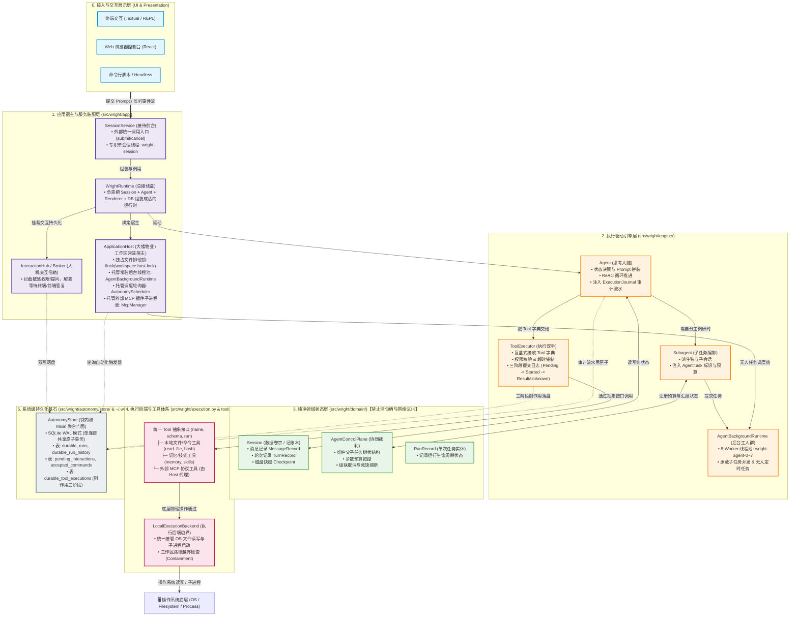
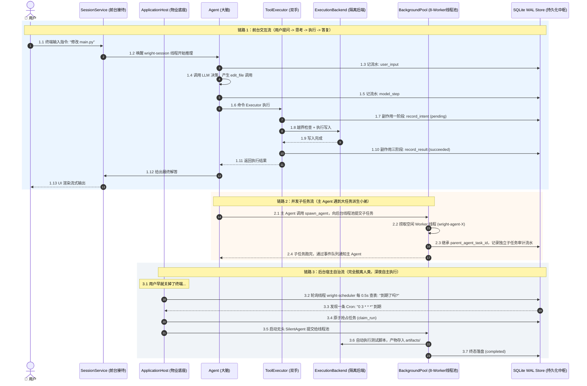

这是一张将前面探讨的所有角色、分层、线程、生命周期与交互链路**全景融合**的系统架构与协作全貌图。

为了让你建立起最清晰的“心智大图”，我们分为三部分呈现：
1. **静态全景架构图（谁包着谁？各模块在哪个物理包？）**
2. **动态端到端协作图（前台对话、子任务派生、后台无人任务三大链路）**
3. **主客从属与生命周期速查矩阵**

---

### 一、静态全景架构图（六大分层与物理模块）

---

### 二、动态端到端协作图（三大核心流向）

整个系统有三种不同的运转方式，它们在内部的流通路径截然不同：

---

### 三、主客从属与生命周期速查表

为了防止再次混淆这几个主体的“上下级”，请牢记这张**权力与生命周期对照表**：

| 实体名称 | 谁拥有/创建它？ | 它活多久？（生命周期） | 线程归属 | 核心权力与职责 |
| :--- | :--- | :--- | :--- | :--- |
| **`ApplicationHost`** | 项目根目录启动时创建（单例） | **最长**（与工作区同寿，会话关了它还在） | 独占调度线程、事件线程、8-Worker 线程池 | **最高主权**：锁住工作区、托管后台守护任务、管理外部 MCP 插件子进程。 |
| **`SessionService`** | UI（TUI / Web 引擎） | 会话期（用户关闭当前 Tab 即销毁） | 拥有独立前台工作线程 `wright-session` | **对外接待门面**：接收用户输入、转发流式事件、挂载交互等待。 |
| **`WrightRuntime`** | 由装配函数装配而成 | 会话期（跟随当前 Session 销毁） | 跨线程对象黏合剂 | **接线板**：把 Session、Agent、DB、Renderer 捆绑在一起，没有专属线程。 |
| **`Agent`** | 由 Runtime 装配 | 单次 Run 或单次对话 | 运行在 `wright-session` 或后台 Worker 线程中 | **推理大脑**：构造 Prompt，请求 LLM，驱动 ReAct 循环。 |
| **`ToolExecutor`** | 由 Agent 装配 | 跟随 Agent 生命周期 | 运行在 Agent 所在的工作线程中 | **执行双手**：查权限、做三阶段 SQLite 提交、盲盒式分发工具调用。 |
| **`Session`** | 由装配层或快照恢复 | 存活于内存，定期序列化落盘 | **无线程**（纯数据结构，只提供方法） | **档案袋**：存储消息列表、快照记录，严禁包含活进程。 |
| **`Coordination`** | 由 Host 或 Session 持有 | 跟随 Host 或 Session | **无线程**（纯仲裁数据结构） | **裁判所**：多 Agent 步数配额、父子从属树、级联取消。 |
| **`AutonomyStore`** | 由 ApplicationHost / Runtime 打开 | 全程保持连接，进程退出才 close | 多线程安全（通过 RLock + WAL） | **可信中枢**：所有状态跃迁的唯一持久化事实源。 |

---

有了这三张图表，再看整个 Wright 项目，所有模块之间的调用方向、层次高低、生命周期长短是不是全部一目了然了？

如果对这幅全景图完全清晰了，我们就可以顺利开启第六次重构的探讨——**第六步：动态多工作目录授权与统一访问控制（Commit `8d448a0`）**！