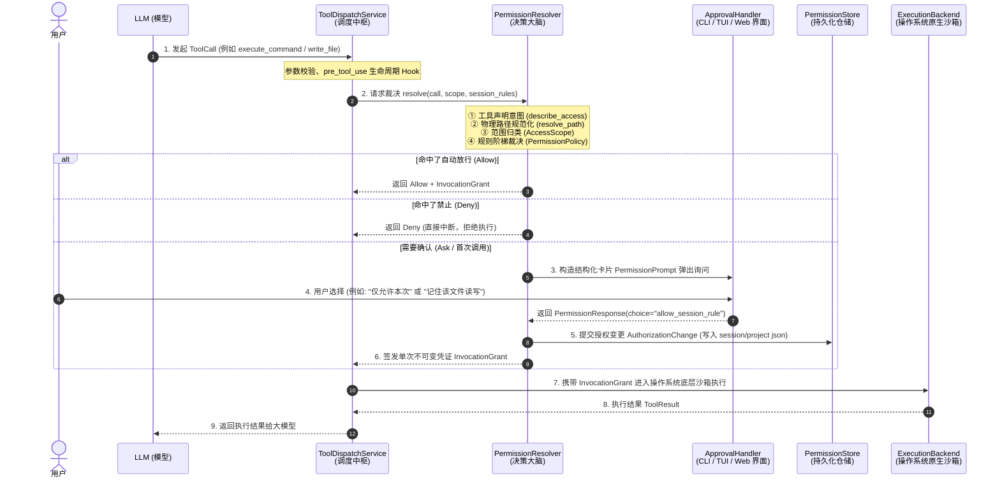

Viewed dispatch.py:1-120
Viewed dispatch.py:200-300
Viewed dispatch.py:301-370

为了让你能**一眼看清全貌**，我们用一个**真实的工具调用场景**，串联起系统里的真实代码文件。

---

### 全景流程图：一次工具调用是如何被“层层把关”的？

---

### 整个大过程分为 5 个核心环节（结合真实代码文件）

我们按数据流的顺序来看每个环节对应的代码：

#### 环节 1：入口与调度中枢
* **核心代码**：[`src/wright/application/tool_execution/dispatch.py`](file:///Users/williamlao/Project/wright/src/wright/application/tool_execution/dispatch.py)
* **做了什么**：
  1. 接收大模型的 `ToolCall`。
  2. 校验参数 Schema 是否合法。
  3. 执行 `pre_tool_use` Hook（如果有修改参数，重新校验）。
  4. 组装当前上下文（工作区 `AccessScope`、会话身份 `InvocationIdentity`、历史规则快照），然后调用 `PermissionResolver.resolve()`。

---

#### 环节 2：纯领域层的裁决大脑（无 I/O、无 UI）
* **核心代码**：[`src/wright/domain/policy/permission/resolver.py`](file:///Users/williamlao/Project/wright/src/wright/domain/policy/permission/resolver.py) 与 [`settings.py`](file:///Users/williamlao/Project/wright/src/wright/domain/policy/permission/settings.py)
* **做了什么**：
  1. **意图提取**：调用工具自身的 `describe_access()`，得到操作集（如 `file_write`）和目标资源。
  2. **物理规范化**：通过后端将相对路径转化为绝对路径，消除 `..` 越界。
  3. **范围分类**：在 [`scope.py`](file:///Users/williamlao/Project/wright/src/wright/domain/policy/permission/scope.py) 中判断目标属于：
     - `IN_ORIGIN`（当前工作区内）
     - `IN_GRANTED`（额外授权的目录）
     - `FORBIDDEN`（受保护的系统/配置文件）
     - `OUTSIDE`（外部路径）
  4. **固定优先级匹配（Precedence Ladder）**：
     $$\text{受保护资源/模式硬限制} \longrightarrow \text{deny 规则} \longrightarrow \text{ask 规则} \longrightarrow \text{allow 规则} \longrightarrow \text{模式默认策略}$$

---

#### 环节 3：交互审批卡片构造与用户响应
* **核心代码**：[`src/wright/domain/policy/permission/approval.py`](file:///Users/williamlao/Project/wright/src/wright/domain/policy/permission/approval.py) 与 [`types.py`](file:///Users/williamlao/Project/wright/src/wright/domain/policy/permission/types.py)
* **做了什么**：
  如果裁决结果是 `ask`（或工具需要人机交互）：
  1. `Resolver` 自动生成一个结构化的 `PermissionPrompt`，计算出本次允许用户选择的选项（`allow_once`、`allow_session_rule`、`allow_project_rule` 等）。
  2. 交付给 UI 适配器（Web/TUI/CLI）。UI 只负责把选项渲染出来，**UI 不能自行发明权限，只能返回服务端给出的选项 ID**。

---

#### 环节 4：状态持久化与凭证签发（Grant）
* **核心代码**：[`src/wright/domain/gateway/permissions.py`](file:///Users/williamlao/Project/wright/src/wright/domain/gateway/permissions.py)
* **做了什么**：
  1. 如果用户选择了记住规则（如 `allow_session_rule`），系统生成 `AuthorizationChange` 并持久化到对应的存储（`session` 存会话内存/快照，`project` 存项目 `permissions.json`）。
  2. 生成一份**仅供本次执行有效**的不可变凭证 `InvocationGrant`（包含允许读写的绝对路径集合、工作目录、是否允许联网等）。

---

#### 环节 5：操作系统级物理沙箱执行
* **核心代码**：[`src/wright/infrastructure/execution/`](file:///Users/williamlao/Project/wright/src/wright/infrastructure/)（如 sandbox 模块）
* **做了什么**：
  拿着 `InvocationGrant` 调用操作系统原生能力执行：
  - **Linux**：启动 Bubblewrap，使用私有 Namespace 和 seccomp 限制网络与系统调用。
  - **macOS**：通过 `sandbox-exec` 应用 Seatbelt 配置。
  - **Windows**：通过受限 SID (Restricted Token) + Job Object + WFP 网络防火墙规则执行。

---

### 架构设计总结

整个权限系统的设计遵循了 **Clean Architecture（整洁架构）**：

| 分层 | 对应模块 | 职责与特点 |
| :--- | :--- | :--- |
| **Domain (领域层)** | `domain/policy/permission/` | **纯纯的规则计算**。不读盘、不发网络、不弹窗，只负责根据输入计算出决策。 |
| **Application (应用层)** | `application/tool_execution/` | **流程编排**。调度 Hook、调用领域层 Resolver、处理异常和结果组装。 |
| **Infrastructure (基础设施层)** | `interfaces/web/` / `sandbox/` | **I/O 与物理执行**。弹窗给用户看、把 JSON 写入磁盘、调用 OS 命令。 |

---

现在整个大流程和每个模块的位置清楚了吗？
接下来我们可以挑一个具体环节深入，你想先看哪一部分？
1. **规则匹配引擎**：`deny` / `ask` / `allow` 和各种模式（`default` / `bypass` / `plan`）具体怎么算？
2. **生命周期与持久化**：`once`、`session`、`project`、`user` 规则是如何存储和继承的？
3. **Shell AST 与网络 Origin 匹配机制**：底层如何防止复杂 Shell 和 URL 逃逸？